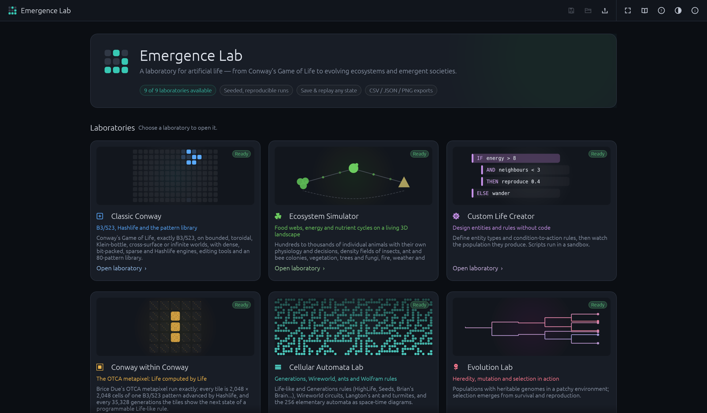
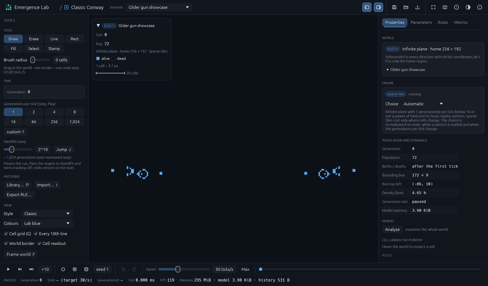
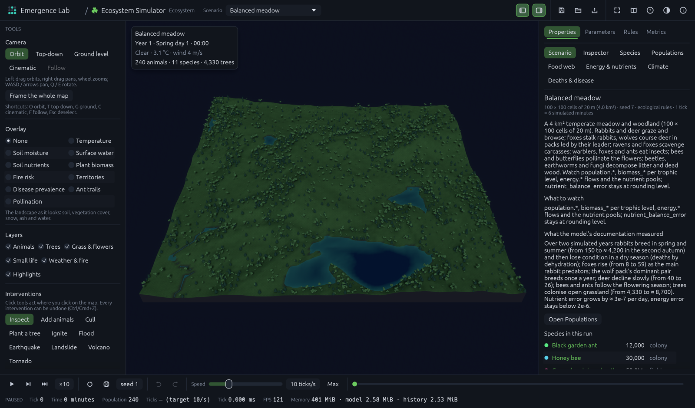
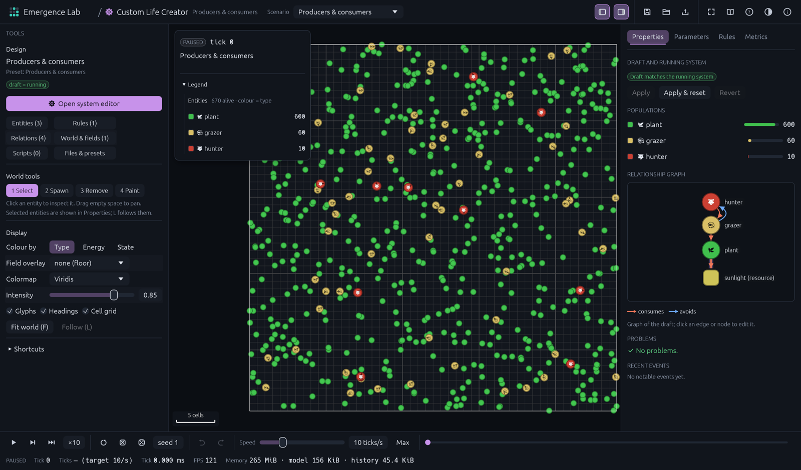
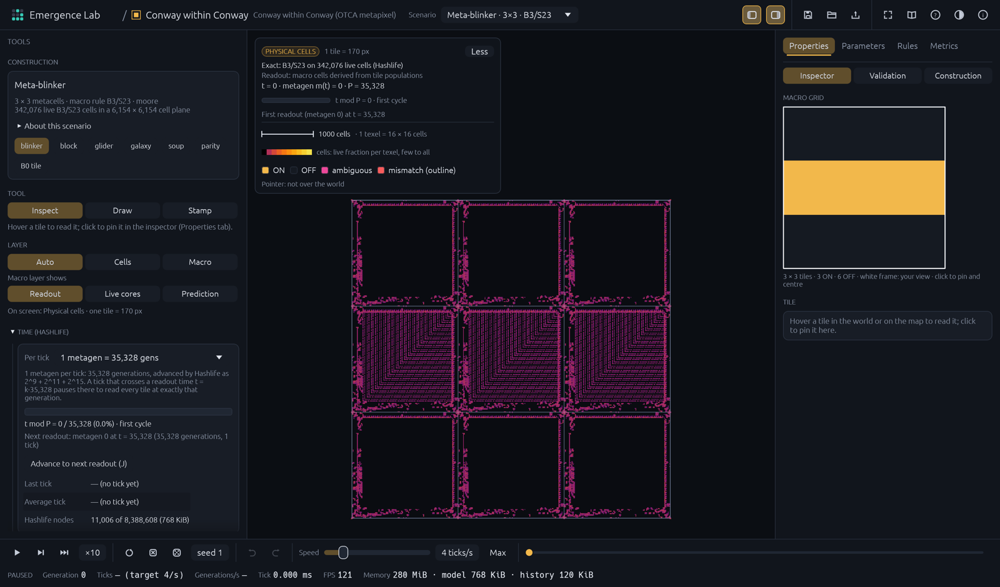
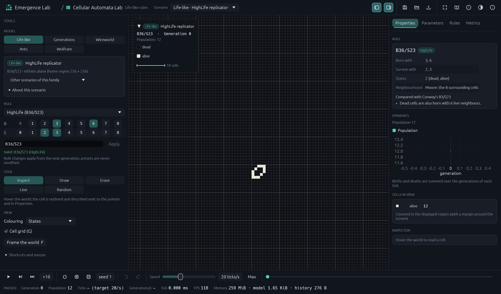
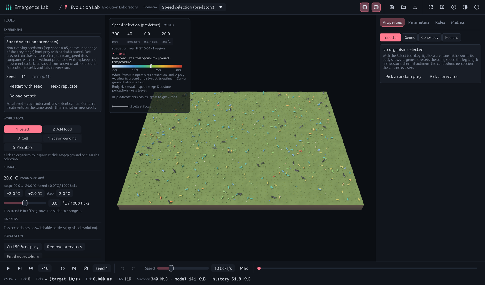
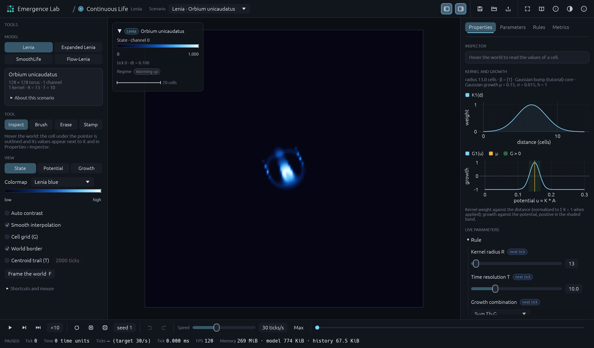
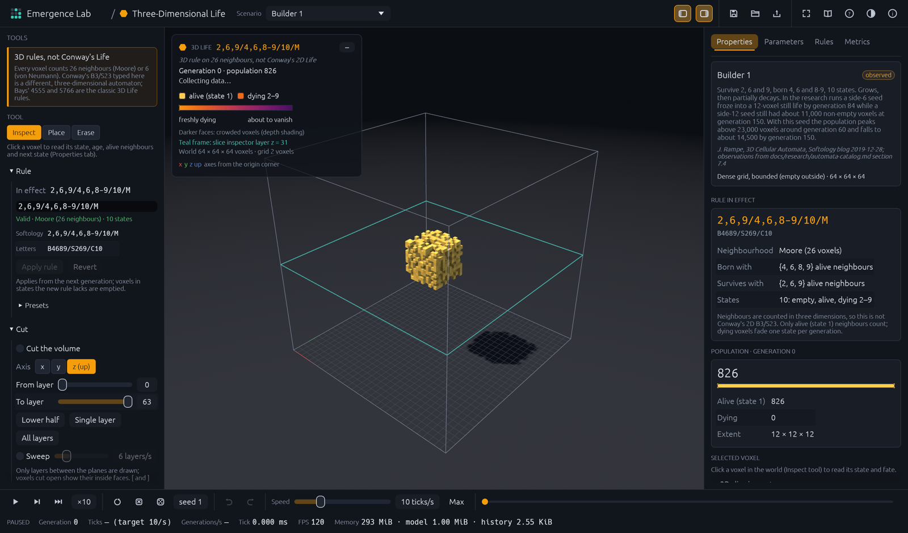
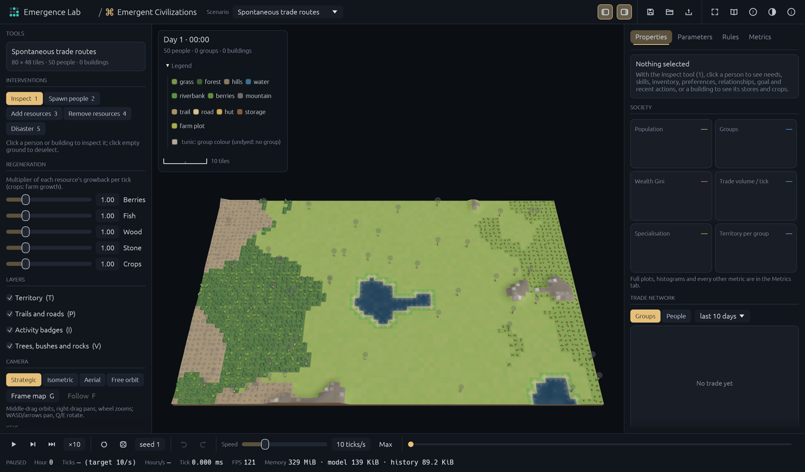

# Emergence Lab

A desktop laboratory for artificial life, written in Rust with Bevy 0.20 and
egui. It goes from Conway's Game of Life — exact B3/S23, Hashlife and the OTCA
metapixel running Life inside Life — to individual-based ecosystems,
evolution, continuous automata, 3D rules and emergent societies. Every model
is deterministic for a given seed, separate from its rendering, and runnable
headless from the command line.



## Laboratories

| | Laboratory | What it simulates |
|---|---|---|
|  | **Classic Conway** | Exact B3/S23 on bounded, toroidal, Klein-bottle, cross-surface and infinite worlds; dense, bit-packed, sparse and Hashlife engines with automatic selection; editing tools, an 80-pattern library with measured metadata, RLE import/export, power-of-two Hashlife jumps. |
|  | **Ecosystem Simulator** | Terrain, biomes, climate, hydrology and fire; 41 animal species as individuals with physiology, behaviour, reproduction, herds, packs and disease; trees, plants and fungi; energy and nutrient ledgers; disasters and interventions; 14 scenarios. |
|  | **Custom Life Creator** | Design entity types, rules (visual builder or DSL), relationships (with a graph) and worlds without code; sandboxed Rhai scripts; 7 presets. |
|  | **Conway Within Conway** | The OTCA metapixel construction run cell by cell under B3/S23 with Hashlife, with the micro and macro views linked by continuous zoom and the exact layer kept apart from the readout. |
|  | **Cellular Automata Lab** | HighLife, Seeds, Day & Night, Life without Death and any B/S rule; Generations (Brian's Brain); Wireworld; Langton's ant and turmites; Wolfram elementary automata. |
|  | **Evolution Lab** | Heritable genomes, mutation, selection that emerges from survival, drift and isolation, with genealogy trees and gene-frequency charts. |
|  | **Continuous Life** | Lenia, expanded multi-channel Lenia, SmoothLife and Flow-Lenia with live kernel and growth plots. |
|  | **3D Life** | Voxel automata with documented 3D rules (not Conway's), slicing and a slice inspector. |
|  | **Emergent Civilizations** | Agents with needs, skills, trade, building and territory; roads, specialisation and groups emerge. |

## Quick start

```bash
git clone https://github.com/Ale-Newport/Conway_GameOfLife.git
cd Conway_GameOfLife
cargo run --release -p emergence-lab
```

Open a laboratory directly with `--mode <slug>` (`classic-conway`,
`ecosystem`, `custom-life`, `conway-within-conway`, `cellular-automata`,
`evolution`, `continuous-life`, `3d-life`, `civilizations`). See
[docs/INSTALLATION.md](docs/INSTALLATION.md) for prerequisites and options and
[docs/USER_GUIDE.md](docs/USER_GUIDE.md) for the interface.

Headless experiments use `emergence-cli` ([README](crates/simulation-cli/README.md)):

```bash
cargo run --release -p simulation-cli -- list scenarios
cargo run --release -p simulation-cli -- run ecosystem/balanced_meadow --ticks 2400 --out meadow.csv
cargo run --release -p simulation-cli -- validate
```

## Performance

Headless, release build, Apple M2 Max (full table, method and caveats in
[docs/PERFORMANCE.md](docs/PERFORMANCE.md)):

| Benchmark | Time per tick |
|---|---:|
| Life 512² torus, bit-packed engine | 0.062 ms (16,012 generations/s) |
| Life 2048² torus, bit-packed engine | 0.129 ms (7,726 generations/s) |
| Life 2048² soup, sparse tiles (infinite plane) | 0.993 ms |
| Hashlife breeder, 1,024 generations per tick | 0.007 ms |
| OTCA metapixel galaxy (7.4 M live cells) | 9.1 ms per step |
| Ecosystem, 1,000 / 10,000 / 100,000 animals | 1.68 / 15.2 / 771 ms |
| Lenia (Orbium) | 0.157 ms |

## Repository layout

```text
apps/desktop          emergence-lab binary: window, assets, mode registration
crates/simulation-core  Simulation trait, runner thread, parameters, snapshots, RNG
crates/<model>        one crate per model (cellular-automata, hashlife, metapixel, ecosystem, ...)
crates/view-<mode>    one Bevy plugin per laboratory
crates/interface      application shell (egui): panels, tutorials, save/load, themes
crates/rendering      grid renderer, cameras, terrain, water, particles, voxels
crates/model-registry, crates/simulation-cli   model catalogue and headless CLI
assets/               patterns, OTCA tiles, species, 3D models, shaders (see licences)
scenarios/            scenario files per laboratory
docs/                 architecture, research, models, guides
scripts/              screenshots and benchmarks
```

## Documentation

* [Architecture](docs/ARCHITECTURE.md), [UI shell contract](docs/UI_SHELL.md), [research](docs/RESEARCH.md)
* [Simulation models](docs/SIMULATION_MODELS.md), [rule engine](docs/RULE_ENGINE.md), [ecosystem](docs/ECOSYSTEM.md), [Hashlife](docs/HASHLIFE.md), [OTCA metapixel](docs/OTCA_METAPIXEL.md)
* [Installation](docs/INSTALLATION.md), [user guide](docs/USER_GUIDE.md), [testing](docs/TESTING.md), [performance](docs/PERFORMANCE.md), [roadmap](docs/ROADMAP.md)
* [Contributing](CONTRIBUTING.md), [changelog](CHANGELOG.md), [asset licences](docs/ASSET_LICENSES.md)

## License

Source code: MIT OR Apache-2.0 ([LICENSE](LICENSE)). Some data files under
`assets/` carry their own licences — notably the OTCA tiles, a few Golly
patterns and one Wireworld gate under GPL-2.0-or-later, read at run time and
never compiled in. See [docs/ASSET_LICENSES.md](docs/ASSET_LICENSES.md).
