<p align="center">
  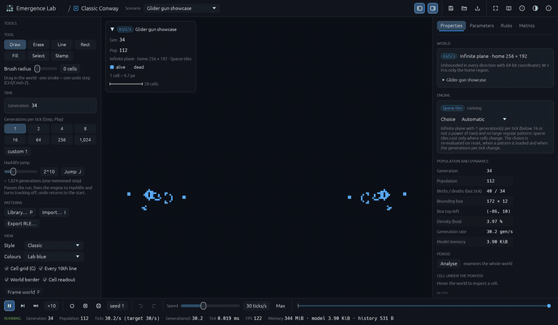
</p>

<h1 align="center">Emergence Lab</h1>

<p align="center">
  <b>A desktop laboratory for artificial life in Rust: Conway's Game of Life, Hashlife and the OTCA metapixel, Lenia, 3D automata, evolving ecosystems and emergent societies, all deterministic and runnable headless.</b>
</p>

<p align="center">
  <a href="https://ale-newport.github.io/Conway_GameOfLife/"></a>
  <a href="https://github.com/Ale-Newport/Conway_GameOfLife/actions/workflows/ci.yml"></a>
  <a href="https://github.com/Ale-Newport/Conway_GameOfLife/actions/workflows/codeql.yml"></a>
  <a href="https://github.com/Ale-Newport/Conway_GameOfLife/releases/latest"></a>
  <a href="#license"></a>
  
  
  <a href="https://scorecard.dev/viewer/?uri=github.com/Ale-Newport/Conway_GameOfLife"></a>
</p>

<p align="center">
  <a href="https://ale-newport.github.io/Conway_GameOfLife/"><b>▶ Try the web demo</b></a> ·
  <a href="#quick-start">Quick start</a> ·
  <a href="https://github.com/Ale-Newport/Conway_GameOfLife/releases/latest">Download</a> ·
  <a href="docs/USER_GUIDE.md">User guide</a> ·
  <a href="CONTRIBUTING.md">Contributing</a>
</p>

Emergence Lab goes from Conway's Game of Life (exact B3/S23, Hashlife and the
OTCA metapixel running Life inside Life) to individual-based ecosystems,
evolution, continuous automata, 3D rules and emergent societies. It is written
in Rust with Bevy 0.20 and egui. Every model is deterministic for a given seed,
kept separate from its rendering, and can run headless from the command line.

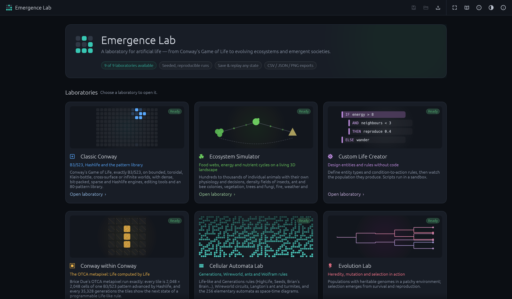

## Highlights

* **Nine laboratories** in one app, each a separate model crate with its own documentation and tests.
* **Exact Life at scale**: dense, bit-packed SWAR, sparse-tile and Hashlife engines with automatic selection.
  The bit-packed engine runs 16,000 generations/s on a 512² torus, and Hashlife jumps
  1,024 generations per tick.
* **Life in Life**: the OTCA metapixel runs cell by cell under B3/S23, with the micro and macro views
  linked by continuous zoom.
* **Deterministic and reproducible**: seeded RNG, replayable runs, snapshots, undo and a headless CLI for
  experiments, comparisons and CSV export.
* **No-code rule design**: the Custom Life Creator has a visual rule builder, a DSL and sandboxed Rhai scripts.
* **Runs in the browser too**: the [web demo](https://ale-newport.github.io/Conway_GameOfLife/) compiles
  the same Life engines to WebAssembly.

## Laboratories

| | Laboratory | What it simulates |
|---|---|---|
| 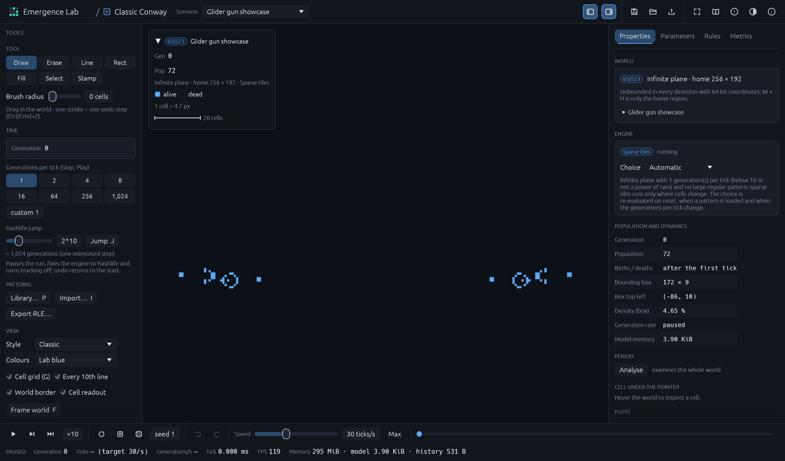 | **Classic Conway** | Exact B3/S23 on bounded, toroidal, Klein-bottle, cross-surface and infinite worlds; dense, bit-packed, sparse and Hashlife engines with automatic selection; editing tools, an 80-pattern library with measured metadata, RLE import/export, power-of-two Hashlife jumps. |
| 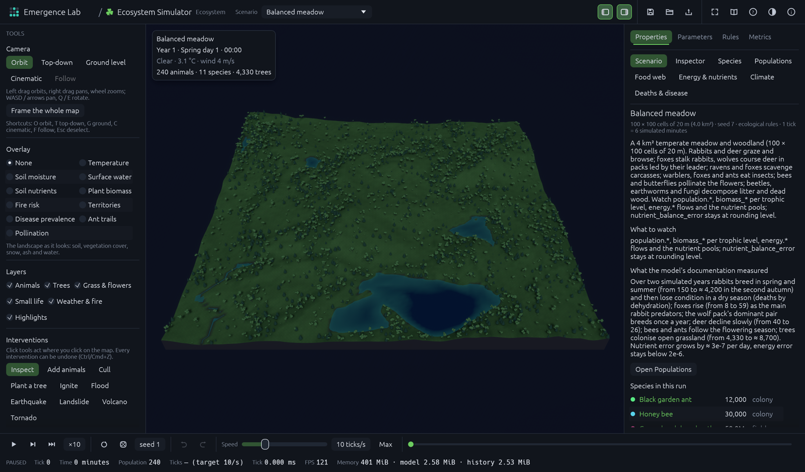 | **Ecosystem Simulator** | Terrain, biomes, climate, hydrology and fire; 41 animal species as individuals with physiology, behaviour, reproduction, herds, packs and disease; trees, plants and fungi; energy and nutrient ledgers; disasters and interventions; 14 scenarios. |
| 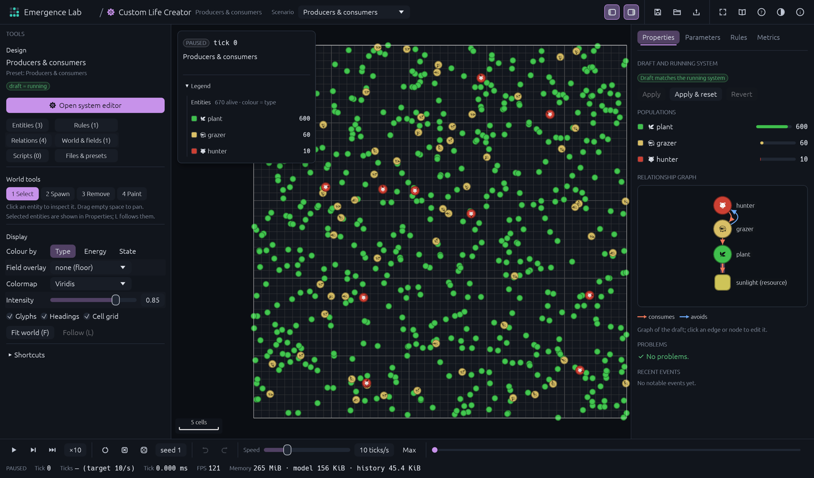 | **Custom Life Creator** | Design entity types, rules (visual builder or DSL), relationships (with a graph) and worlds without code; sandboxed Rhai scripts; 7 presets. |
| 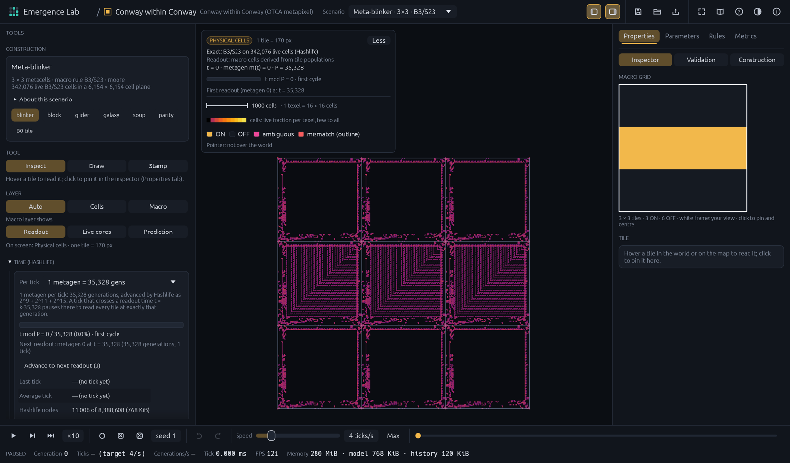 | **Conway Within Conway** | The OTCA metapixel construction run cell by cell under B3/S23 with Hashlife, with the micro and macro views linked by continuous zoom and the exact layer kept apart from the readout. |
| 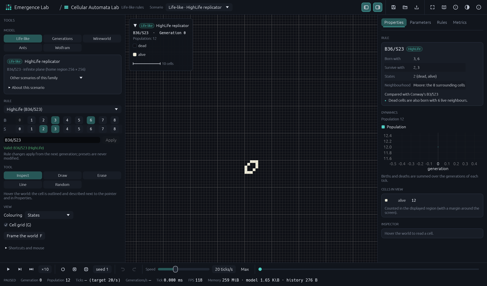 | **Cellular Automata Lab** | HighLife, Seeds, Day & Night, Life without Death and any B/S rule; Generations (Brian's Brain); Wireworld; Langton's ant and turmites; Wolfram elementary automata. |
| 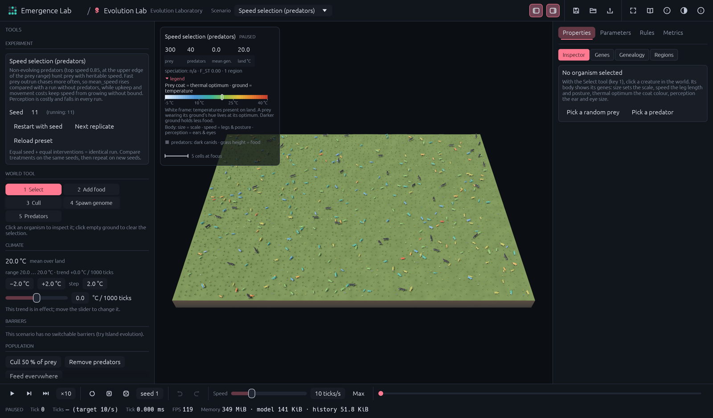 | **Evolution Lab** | Heritable genomes, mutation, selection that emerges from survival, drift and isolation, with genealogy trees and gene-frequency charts. |
| 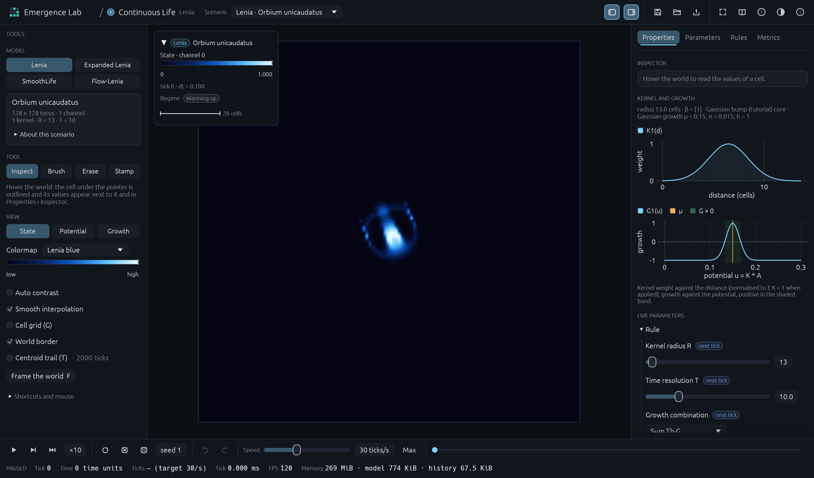 | **Continuous Life** | Lenia, expanded multi-channel Lenia, SmoothLife and Flow-Lenia with live kernel and growth plots. |
| 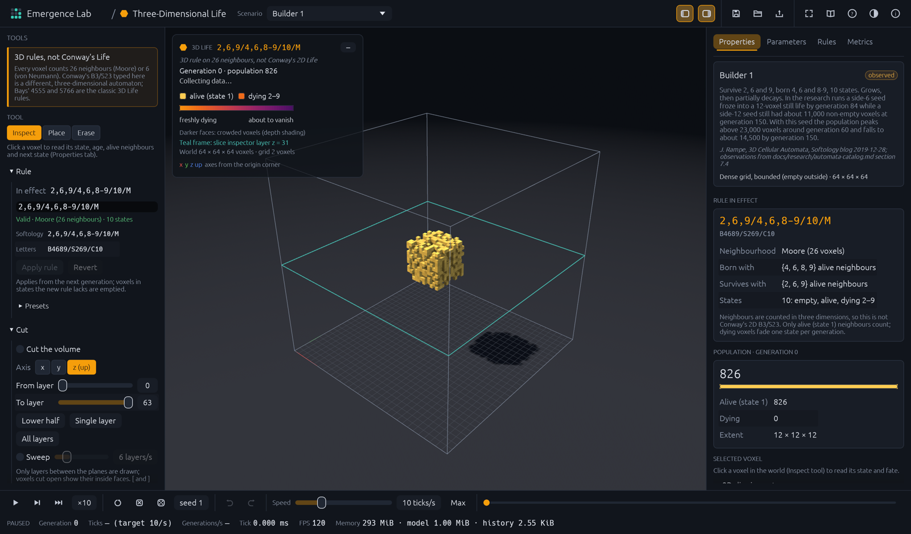 | **3D Life** | Voxel automata with documented 3D rules (not Conway's), slicing and a slice inspector. |
| 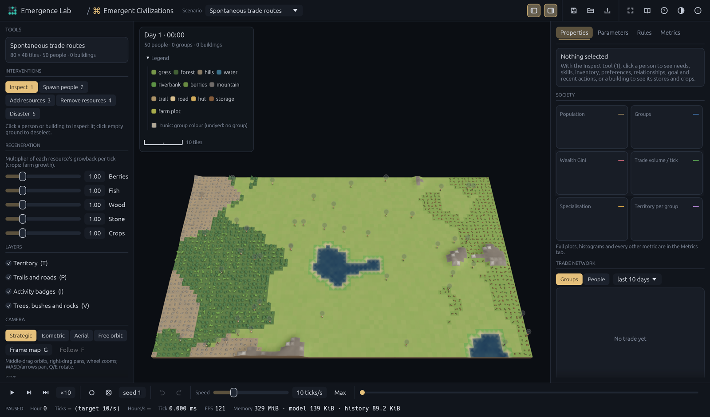 | **Emergent Civilizations** | Agents with needs, skills, trade, building and territory; roads, specialisation and groups emerge. |

## Quick start

**Download** a prebuilt archive for Linux, macOS or Windows from the
[latest release](https://github.com/Ale-Newport/Conway_GameOfLife/releases/latest),
extract it and run `emergence-lab` (the `assets/` folder must stay next to it).

**Or build from source** with [Rust 1.95+](https://rustup.rs), in one command:

```bash
git clone https://github.com/Ale-Newport/Conway_GameOfLife.git && cd Conway_GameOfLife && cargo run --release -p emergence-lab
```

On Linux, install Bevy's system packages first (Debian/Ubuntu:
`sudo apt install pkg-config libudev-dev libx11-dev libxkbcommon-dev libwayland-dev libasound2-dev`).

Open a laboratory directly with `--mode <slug>` (`classic-conway`,
`ecosystem`, `custom-life`, `conway-within-conway`, `cellular-automata`,
`evolution`, `continuous-life`, `3d-life`, `civilizations`). See
[docs/INSTALLATION.md](docs/INSTALLATION.md) for prerequisites and options and
[docs/USER_GUIDE.md](docs/USER_GUIDE.md) for the interface.

Headless experiments use `emergence-cli` ([README](crates/simulation-cli/README.md)):

```bash
cargo run --release -p simulation-cli -- list scenarios
cargo run --release -p simulation-cli -- run ecosystem/balanced_meadow --ticks 2400 --out meadow.csv
cargo run --release -p simulation-cli -- validate
```

## Performance

Headless, release build, Apple M2 Max (full table, method and caveats in
[docs/PERFORMANCE.md](docs/PERFORMANCE.md)):

| Benchmark | Time per tick |
|---|---:|
| Life 512² torus, bit-packed engine | 0.062 ms (16,012 generations/s) |
| Life 2048² torus, bit-packed engine | 0.129 ms (7,726 generations/s) |
| Life 2048² soup, sparse tiles (infinite plane) | 0.993 ms |
| Hashlife breeder, 1,024 generations per tick | 0.007 ms |
| OTCA metapixel galaxy (7.4 M live cells) | 9.1 ms per step |
| Ecosystem, 1,000 / 10,000 / 100,000 animals | 1.68 / 15.2 / 771 ms |
| Lenia (Orbium) | 0.157 ms |

## Repository layout

```text
apps/desktop          emergence-lab binary: window, assets, mode registration
apps/web              emergence-web: the browser demo (WebAssembly)
crates/simulation-core  Simulation trait, runner thread, parameters, snapshots, RNG
crates/<model>        one crate per model (cellular-automata, hashlife, metapixel, ecosystem, ...)
crates/view-<mode>    one Bevy plugin per laboratory
crates/interface      application shell (egui): panels, tutorials, save/load, themes
crates/rendering      grid renderer, cameras, terrain, water, particles, voxels
crates/model-registry, crates/simulation-cli   model catalogue and headless CLI
assets/               patterns, OTCA tiles, species, 3D models, shaders (see licences)
scenarios/            scenario files per laboratory
docs/                 architecture, research, models, guides
scripts/              screenshots, demo recording, web build and benchmarks
```

## Documentation

* [Architecture](docs/ARCHITECTURE.md), [UI shell contract](docs/UI_SHELL.md), [research](docs/RESEARCH.md)
* [Simulation models](docs/SIMULATION_MODELS.md), [rule engine](docs/RULE_ENGINE.md), [ecosystem](docs/ECOSYSTEM.md), [Hashlife](docs/HASHLIFE.md), [OTCA metapixel](docs/OTCA_METAPIXEL.md)
* [Installation](docs/INSTALLATION.md), [user guide](docs/USER_GUIDE.md), [testing](docs/TESTING.md), [performance](docs/PERFORMANCE.md), [roadmap](docs/ROADMAP.md)
* [Contributing](CONTRIBUTING.md), [code of conduct](CODE_OF_CONDUCT.md), [security policy](SECURITY.md), [changelog](CHANGELOG.md), [asset licences](docs/ASSET_LICENSES.md)

## Web demo

[ale-newport.github.io/Conway_GameOfLife](https://ale-newport.github.io/Conway_GameOfLife/)
runs the Classic Conway engines in your browser: 11 Life-like rule presets,
the 18 embedded classic patterns, drawing and a live engine readout. The page is
[`apps/web`](apps/web): a small `wasm-bindgen` wrapper (`emergence-web`) over
the `cellular-automata` crate. Build it locally with
[`scripts/build_web.sh`](scripts/build_web.sh).

## Contributing

Contributions are welcome. Bug reports, new rules, models, docs and
performance work are all useful. Start with [CONTRIBUTING.md](CONTRIBUTING.md) and the issues labelled
[`good first issue`](https://github.com/Ale-Newport/Conway_GameOfLife/labels/good%20first%20issue)
or [`help wanted`](https://github.com/Ale-Newport/Conway_GameOfLife/labels/help%20wanted).
Questions and experiments go in
[Discussions](https://github.com/Ale-Newport/Conway_GameOfLife/discussions).
Please report security issues privately (see [SECURITY.md](SECURITY.md)).

If you use Emergence Lab in research or teaching, you can cite it with
[CITATION.cff](CITATION.cff).

## License

Source code: MIT OR Apache-2.0 ([LICENSE](LICENSE)). Some data files under
`assets/` carry their own licences — notably the OTCA tiles, a few Golly
patterns and one Wireworld gate under GPL-2.0-or-later, read at run time and
never compiled in. See [docs/ASSET_LICENSES.md](docs/ASSET_LICENSES.md).
