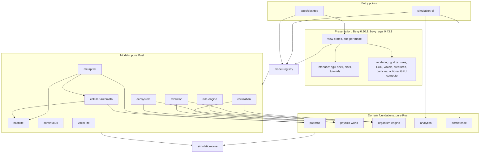
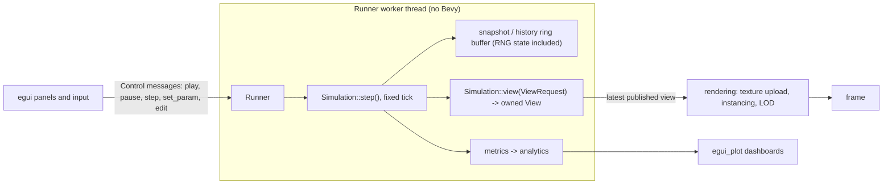

# Emergence Lab — Research Synthesis

Synthesis of the nine research notes written for Emergence Lab on 2026-11-09. It lists what we reviewed, the
algorithms we will implement, the trade-offs, the decisions and the open issues. The detailed notes hold the full
derivations, grammars, data tables and reproduction steps:

| Detailed note | Scope |
|---|---|
| [`research/life-engines-hashlife.md`](research/life-engines-hashlife.md) | Life semantics, Golly rule strings, QuickLife/HashLife internals, a clean-room Hashlife design, dense and sparse engines, file formats, finite topologies |
| [`research/pattern-library.md`](research/pattern-library.md) | The 80-pattern B3/S23 library in `assets/patterns/`: sources, verification method, results, licensing |
| [`research/otca-metapixel.md`](research/otca-metapixel.md) | OTCA metapixel geometry, programming, timing, readout, golden values, Rust test plan |
| [`research/automata-catalog.md`](research/automata-catalog.md) | Life-like family, Generations, Wireworld, Langton's ant and turmites, Wolfram ECA, 3D CA, unit-test checklist |
| [`research/continuous-life.md`](research/continuous-life.md) | Lenia, Extended Lenia, SmoothLife, Flow-Lenia; FFT, precision, parallelism, GPU threshold, test oracles |
| [`research/ecology-alife.md`](research/ecology-alife.md) | Predator–prey, metabolism and allometry, vegetation, fungi, nutrients, fire, terrain, hydrology, agent AI, evolution, societies, species tables |
| [`research/rules-scripting.md`](research/rules-scripting.md) | Sandboxed Rhai 1.27.0, the rule DSL (grammar, IR, validation, evaluation order), relationship compiler, egui graph crates |
| [`research/bevy-0.20-api.md`](research/bevy-0.20-api.md) | Verified Bevy 0.20.1 / bevy_egui 0.43.1 / egui 0.36.2 / egui_plot 0.37.0 / bevy_panorbit_camera 0.36.0 API crib sheet |
| [`research/assets-3d.md`](research/assets-3d.md) | Licence-safe 3D models and animations in `assets/models/`, Bevy integration, procedural-animal strategy |

**Evidence labels.** This document keeps the labels of the notes. *Measured* means run on the development machine
(Apple M2 Max, 8 performance + 4 efficiency cores, 64 GB, Rust 1.98.1). *[SIM]* means reproduced with a throw-away
reference simulator kept in the session scratchpad, not in the repository. *Verified (source)* means read in the
primary source or crate source. **UNVERIFIED** marks anything not confirmed; it is carried over unchanged from the notes.
The scratchpad prototypes (Python Hashlife, Python pattern verifier, numpy Lenia, Rust benchmarks) are temporary and are
not project code. The Lenia benchmarks ran while the machine was heavily loaded, so they are upper bounds.

## Table of contents

1. [Projects reviewed and links](#1-projects-reviewed-and-links)
2. [Relevant algorithms](#2-relevant-algorithms)
3. [Advantages and limitations of each approach](#3-advantages-and-limitations-of-each-approach)
4. [Justified technical decisions](#4-justified-technical-decisions)
5. [Scientific and mathematical sources](#5-scientific-and-mathematical-sources)
6. [Proposed architecture](#6-proposed-architecture)
7. [Expected performance problems and mitigations](#7-expected-performance-problems-and-mitigations)
8. [Licenses of code, patterns and graphic resources](#8-licenses-of-code-patterns-and-graphic-resources)

---

## 1. Projects reviewed and links

### 1.1 Life engines, Hashlife, patterns and formats

| Project | Link | What we learned | License |
|---|---|---|---|
| Golly 5.1 (local clone, commit `9a7079a8`) | <https://sourceforge.net/projects/golly/> | Rule-string grammar (`liferules`), Generations semantics, QuickLife and HashLife internals, GC, bounded-grid emulation, format detection, RLE/Macrocell quirks, `3D.lua` notation. Read only; clean-room. The OTCA note also built `bgolly` in the scratchpad to validate the metapixel (§2.4). | GPL-2.0-or-later |
| Golly help pages | <https://golly.sourceforge.io/Help/formats.html>, `bounded.html`, `Algorithms/*.html` | Format grammars, bounded topologies, B0 emulation | GPL-2.0-or-later (distribution) |
| lifelib (A. P. Goucher) | <https://gitlab.com/apgoucher/lifelib> | Safe algorithmic reference (Hashlife, StreamLife, SIMD) for porting with attribution | MIT |
| gol_engines 0.3.1 | <https://github.com/das67333/gol_engines> | Fastest Rust engine with published benchmarks; parallel HashLife (29.3× on 32 cores for 0E0P); step reduction under memory pressure | GPL-3.0 (benchmark reference only) |
| smeagol 0.1.2 | <https://crates.io/crates/smeagol> | Hashlife + SIMD, needs nightly `packed_simd`, last release 2019 | MPL-2.0 (unmaintained) |
| golback 0.3.4 | <https://crates.io/crates/golback> | Young Hashlife with one-cell leaves; possible MIT cross-check | MIT |
| `hashlife` 0.0.0, `lari`, `conway`, `life-backend` | crates.io | Placeholder, GPL, GPL, archived respectively | mixed; none usable |
| ca-formats / ca-rules 0.3.5 | <https://docs.rs/ca-formats/0.3.5>, <https://docs.rs/ca-rules/0.3.5> | Parsers for RLE/Macrocell/apgcode and for rule strings; good dev-dependency oracles | MIT |
| rlifesrc-lib 0.6.1 | <https://crates.io/crates/rlifesrc-lib> | SAT-like pattern search; possible evolution-lab use | MIT |
| bevy_life 0.13.0 | <https://crates.io/crates/bevy_life> | Entity per cell, targets bevy 0.18; does not scale, wrong Bevy version | MIT ("non-standard" in crates.io metadata) |
| Life Lexicon Release 29 | <https://conwaylife.com/ref/lexicon/lex_home.htm> (bundled in Golly `Help/Lexicon`) | Cell diagrams for 39 library patterns; periods, speeds, discoverers | CC BY-SA 3.0 |
| LifeWiki (read via mirror) | <https://conwaylife.njohnston.ca/wiki/> (canonical `conwaylife.com/wiki`, blocked by a bot challenge, not bypassed) | Format pages, infobox facts | content licence UNVERIFIED |
| Gosper 1984; Rokicki 2006 | §5.1 | Hashlife algorithm; breeder population test vector | copyrighted, cited only |

### 1.2 OTCA metapixel

| Project | Link | What we learned | License |
|---|---|---|---|
| Brice Due's OTCA tiles and Perl tiler | <http://www.cranemtn.com/life/weblog/> | Canonical ON/OFF tiles, programming instructions in the header, Method B tiling | no explicit licence (treated as GPL data, §8) |
| OTCAMP weblog "How Does It Work?" | <http://web.archive.org/web/20231121112256/https://otcametapixel.blogspot.com/2006/05/how-does-it-work.html> | Slide captions for the internal mechanism (interpretation UNVERIFIED) | copyrighted, viewed only |
| B3S23 blog post | <http://b3s23life.blogspot.com/2006/09/brice-dues-game-of-life-metapixel.html> | Tile header and sample links | viewed only |
| Golly `metafier.lua` / `metafier.py`, `Patterns/HashLife/Metacell/*.mc.gz` | Golly tree | Tile composition, rule-bit template; three demo tilings used as acceptance tests | GPL-2.0-or-later |

### 1.3 Other cellular automata and 3D CA

| Project | Link | What we learned | License |
|---|---|---|---|
| CelLab manual (Rucker & Walker) | <https://www.fourmilab.ch/cellab/manual/chap4.html> | Vote/Majority definitions, Brian's Brain | cited only |
| Softology "3D Cellular Automata" (J. Rampe) | <https://softologyblog.wordpress.com/2019/12/28/3d-cellular-automata-3/> | `S/B/C/N` rule set, Generations semantics in 3D | rule strings cited as facts |
| Bays 3D Life papers | <https://wpmedia.wolfram.com/sites/13/2018/02/01-3-1.pdf> (and §5.2) | 4555/5766/5655/6855, theorems on gliders and growth, FCC lattice | copyrighted, cited |
| OEIS A255938, A051023, A001316 | <https://oeis.org/A255938> etc. | Langton's ant, rule 30, rule 90 test vectors | CC BY-SA 4.0 (UNVERIFIED) |

### 1.4 Continuous cellular automata

| Project | Link | What we learned | License |
|---|---|---|---|
| Chakazul/Lenia (`LeniaND*.py`, `animals.json`, `Lenia-LifeForms.js`) | <https://github.com/Chakazul/Lenia> @ `adfc5429` | Executed kernel/growth mapping (kn=1, gn=1 → polynomial/polynomial), RLE cell format, 239 surveyed species | MIT |
| lenia-org/Lenia-Tutorial | <https://github.com/lenia-org/Lenia-Tutorial> @ `2642cf99` | Canonical Orbium fixture, multi-channel presets | MIT |
| erwanplantec/FlowLenia (JAX) | <https://github.com/erwanplantec/FlowLenia> @ `dce428c6` | Code conventions that differ from the paper | no licence file (read only) |
| SmoothLife (S. Rafler) | <https://sourceforge.net/projects/smoothlife/> | Time-stepping modes 0–2 | GPLv2 per SourceForge listing (UNVERIFIED in-file) |
| GollyGang/Ready SmoothLife patterns | <https://github.com/GollyGang/ready> | SmoothLifeL parameters, alternative transition mixing | GPL-3.0 (parameters only) |
| rustfft 6.4.1 / realfft 3.5.1 | crates.io | NEON-accelerated FFT; r2c/c2r with DC/Nyquist caveat | MIT OR Apache-2.0 / MIT |

### 1.5 Engine, rendering and UI crates

| Project | Link | What we learned | License |
|---|---|---|---|
| Bevy 0.20.1 (sources and examples) | <https://docs.rs/bevy/0.20.1>, <https://github.com/bevyengine/bevy/tree/v0.20.1/examples> | Verified API (renames, WESL shaders, dynamic textures, picking, glTF animation, compute example, asset roots); see the crib sheet | MIT OR Apache-2.0 |
| bevy_egui 0.43.1 | <https://github.com/vladbat00/bevy_egui> | `EguiPrimaryContextPass`, egui panels not reported by `EguiWantsInput`, side-panel viewport pattern | MIT (licence text UNVERIFIED) |
| egui 0.36.2, egui_plot 0.37.0 | <https://github.com/emilk/egui>, <https://github.com/emilk/egui_plot> | Panel API rename, plot API; egui_plot 0.36 would pull a second egui | MIT OR Apache-2.0 (egui verified; egui_plot UNVERIFIED) |
| bevy_panorbit_camera 0.36.0 | <https://github.com/Plonq/bevy_panorbit_camera> | Needs its `bevy_egui` feature; name clash with Bevy's own camera controller | MIT OR Apache-2.0 |
| egui_graphs 0.32.0 / egui-snarl 0.12.0 | <https://github.com/blitzarx1/egui_graphs>, <https://github.com/zakarumych/egui-snarl> | Both resolve to a single egui 0.36.2 with bevy_egui 0.43.1 and run headless | MIT / MIT OR Apache-2.0 |
| egui-graph-edit 0.9.1, egui_node_graph2 0.7.0 | GitHub | Depend on egui 0.35 / 0.29: incompatible | MIT |

### 1.6 Scripting and rule-DSL references

| Project | Link | What we learned | License |
|---|---|---|---|
| Rhai 1.27.0 | <https://github.com/rhaiscript/rhai>, <https://rhai.rs/book> | `Engine::new()` is not a sandbox; limits API; `eval` built in; `call_fn` re-runs top level; costs | MIT OR Apache-2.0 |
| NetLogo dictionary | <https://docs.netlogo.org/dictionary.html> | Agent vocabulary; random `ask` order | design reference |
| GAMA / GAML | <https://gama-platform.org/wiki/DefiningActionsAndBehaviors> | `reflex … when:` is the closest model to WHEN/THEN | design reference |
| StarLogo Nova, Scratch/scratch-blocks | <https://wiki.slnova.org/wiki/On_Collision_With_Do>, <https://github.com/scratchfoundation/scratch-blocks> | Event hats, typed slots | scratch-blocks Apache-2.0 (not used) |
| CLIPS, Rete | <https://www.csie.ntu.edu.tw/~sylee/courses/clips/bpg/node5.3.html> | Salience = priority; explicit tie-break; Rete unnecessary | design reference |

### 1.7 Ecology, agent-based models and data

| Project | Link | What we learned | License |
|---|---|---|---|
| NetLogo Wolf Sheep Predation (Wilensky 1997) | <https://ccl.northwestern.edu/netlogo/models/WolfSheepPredation>, <https://github.com/NetLogo/models> | Defaults and per-tick rules; grass version persists, no-grass collapses (re-implemented) | CC BY-NC-SA 3.0 (model); NetLogo GPL — rules only |
| Mesa Sugarscape G1MT | <https://mesa.readthedocs.io/stable/examples/advanced/sugarscape_g1mt.html> | Trade formulas confirming Kehoe's spec | Apache-2.0 (from knowledge, UNVERIFIED) |
| Kehoe, *The Specification of Sugarscape* | <https://arxiv.org/abs/1505.06012> | Formal rules G, M, R, S, K, C, I, T, L, E | arXiv preprint |
| Phylotrack | <https://arxiv.org/abs/2405.09389> | Pruned systematics manager to re-implement in Rust | MIT |
| AnAge Build 15 (HAGR) | <https://genomics.senescence.info/species/> | Metabolic rate, longevity, maturity, Gompertz parameters; fitted allometries | CC BY 3.0 |
| PanTHERIA 1.0 | <https://esapubs.org/archive/ecol/E090/184/> | Mammal life history, home range, density | no restrictions (cite) |
| Hirt et al. 2017 supplement | §5.4 | Maximum-speed model parameters | individual facts cited |
| plotbiomes | <https://github.com/valentinitnelav/plotbiomes> | Whittaker polygons derive from a copyrighted figure: not used | code MIT |
| noise 0.9.0, rand_chacha 0.10.0 | local registry | Fractal defaults (Fbm lacunarity 2π/3); `set_stream` / `set_word_pos` | Apache-2.0/MIT; MIT OR Apache-2.0 |
| Google DeepMind publication 106327 | <https://deepmind.google/research/publications/106327/> | It is the Flow-Lenia *Artificial Life* paper | — |

### 1.8 3D models

| Project | Link | What we learned | License |
|---|---|---|---|
| Quaternius packs (Ultimate Animated Animals, Farm, Easy Enemy, Animated Monster, Animated Fish, Stylized Nature MegaKit) | <https://quaternius.com>, mirrored at <https://poly.pizza/u/Quaternius> | Best CC0 animated coverage; FBX2glTF artefacts to fix; new site-wide QAL v1.0 is not CC0 | CC0 1.0 per pack page |
| Kenney Nature Kit v2.1 | <https://kenney.nl/assets/nature-kit> | Props and far-LOD proxies | CC0 1.0 |
| Sherkiz "Hawk Lp Rigged", "Rabbit" (Poly Pizza) | <https://poly.pizza/m/RkN6MEbP6g>, <https://poly.pizza/m/Km89u3twcR> | Only animated bird found; rabbit | CC BY 3.0 (uploader identity UNVERIFIED) |
| Khronos glTF Fox | <https://github.com/KhronosGroup/glTF-Sample-Assets/tree/main/Models/Fox> | Same fox as Bevy examples; not installed | CC0 model + CC-BY 4.0 rig/animation |
| KayKit Forest, OpenGameArt birds, Poly Haven, three.js birds, Sketchfab | see the assets note | Candidates not installed (purchase flow, `.blend` only, photoreal style, unclear licence, login) | CC0 / CC-BY 3.0 / CC0 / unclear / per model |

---

## 2. Relevant algorithms

### 2.1 Life and life-like engines

**Semantics.** Life is the synchronous, Moore-neighbourhood, outer-totalistic rule B3/S23 on Z². With `n` live
neighbours and `T = n + s` (the 3×3 total), `s' = 1` iff `T = 3` or (`T = 4` and `s = 1`). Information moves at most one
cell per generation (speed c), which is what bounds Hashlife's padding. Coordinates follow RLE and Golly: x right, y down.

**Rule strings (Golly 5.1 `liferules::setrule`, verified by reading).** Case-insensitive; `B…/S…` with or without the
slash; `S…/B…`; legacy `23/3` means **survival first** (so `3/23` is not Life); optional `H` (hexagonal: ignores NE and
SW) or `V` (von Neumann) suffix; Hensel isotropic letters with `-` for "all except"; `MAP` + base64 (86/22/6 characters,
MSB-first by 3×3 index); `Wn` for elementary CA (n even, ≤ 254). Canonical output is `B…/S…` with sorted digits.
**B0 rules:** with Smax they are equivalent to the complementary rule (`B0123478/S01234678` → `B3/S23`); without Smax
QuickLife alternates two rules on even and odd generations; HashLife accepts B0 only with Smax. A rule is
self-complementary iff `B = { 8 − k : k ∉ S }` [SIM].

**Bounded grids.** Suffix `:` + topology letter (`P` plane, `T` torus, `K` Klein bottle, `C` cross-surface, `S` sphere) +
width (optional `*` twist, `+n`/`-n` shift) + `,` + height. 0 means infinite (not for K, C, S); only one edge pair may be
shifted; the sphere needs w = h; the top-left cell is `(−int(w/2), −int(h/2))`. Golly emulates every bounded grid by
stepping one generation at a time and copying edge cells into a one-cell border ring. Neighbour mappings (validated
against every Golly help diagram): torus wraps; shifted torus adds the shift when crossing the shifted edge; Klein bottle
reflects (`x = w−1−x`) across the twisted pair; cross-surface twists both pairs; sphere joins top↔left and right↔bottom
(`(−1, y) → (y, 0)`). For the twisted-and-shifted Klein bottle Golly's code and diagram differ by a 2-column translation
(**UNVERIFIED** at runtime).

**Dense bit-packed SWAR engine.** 64 cells per `u64`, row-major. For each output row, form west/east-shifted words for
the rows above, at and below; sum with full adders into a weight-1 bit and four weight-2 carries; "count ∈ {2,3}" is
"exactly one weight-2 bit set"; `next = (ones | centre) & exactly_one` for B3/S23. About 30 bitwise operations per 64
cells plus about 6 for shifts. Validated against a naive simulator. Generic outer-totalistic rules use a 4-bit-plane
adder tree; Hensel and MAP rules use QuickLife's 65,536-entry 4×4→2×2 table; Generations uses bit-planes plus an
"alive = state 1" plane. Bounded topologies use a ghost ring (bit-reversed rows for twists, transposed columns for the
sphere, funnel-shifted rows for shifts, masking past width w).

**Sparse tiled engine.** 64×64-cell tiles (`[u64; 64]`, 512 B) in a hash map over a tile arena, with halos from the
8 neighbours. Active set: a tile is recomputed at t+1 only if it or a neighbour changed between t−1 and t; neighbours are
allocated only when edge cells are live; empty tiles are freed with hysteresis. Each candidate tile is a pure function of
9 old tiles, so `rayon` over candidates is deterministic. This is a coarser version of QuickLife's per-block change flags.

**Engine selection (Golly experience plus our measurements).** Bounded worlds, dense soups and per-generation animation
→ flat SWAR. Unbounded, mostly empty worlds → tiles + active set. Highly regular structure or huge time scales (guns,
breeders, OTCA) → Hashlife. High-entropy chaos over huge areas → tiles or SWAR, never Hashlife (Golly's help: HashLife
"performs very poorly on highly chaotic patterns"). The engines must be bit-for-bit equivalent; a property test compares
them on random soups.

### 2.2 Hashlife

**Definitions** (Gosper 1984; Rokicki 2006). A node at level L is a canonical, interned 2^L × 2^L square with children
`[nw, ne, sw, se]`; equal contents ⇔ equal ids. `result(n, j)` (0 ≤ j ≤ L−2) is the level-(L−1) centre after 2^j
generations; the light-cone argument makes it well defined.

- **Full speed (j = L−2):** build 9 overlapping level-(L−1) squares from grandchildren, take their results at L−3, join
  them into 4 squares, take those results at L−3, join the 4.
- **Slow step (j < L−2):** variant A (Golly `ghashbase`): take the 9 centres without time advance, join 4 squares, take
  results at j. Variant B (Golly `hlifealgo`): take the 9 results at j, then reassemble inner quarters. Both were validated
  against a naive simulator; which is faster is **UNVERIFIED**.
- **Top level:** expand the root twice, then until level ≥ j + 3; take the result; shrink while the 12 outer grandchildren
  are empty. Arbitrary N uses binary decomposition (any order is correct). Golly's hyperspeed raises the step exponent by
  1 every 64 steps.
- **Torus of side 2^k:** `T' = roll(result(join(T,T,T,T), j))` with `roll(X) = join(X.se, X.sw, X.ne, X.nw)`, j ≤ k−1
  (validated).
- **Population:** per-node saturating `u64` is exact up to level 31; the root needs `u128`/BigUint (breeder at 10^12
  generations has 1,302,083,334,180,208,337,404 cells, about 1.3×10^21).

**Golly's HashLife (read, not copied).** 48-byte nodes (hash link, 4 children, cached result); 8×8 leaves stored as four
4×4 `u16` quadrants with 1- and 2-generation results precomputed from a 65,536-entry table; hash over child pointers with
move-to-front chains, resize at load 0.7; step = non-power-of-two multiplier × 2^ngens with a **global** ngens, so a step
change triggers a GC and a sweep of cached results; mark-and-sweep GC that can run mid-recursion using a stack of
in-progress results; population computed lazily as a bigint; nodes of one screen pixel are drawn on/off, not as density.

**Our design (validated pseudo-code in the note, §3).** Arena `Vec<Node>` with `u32` ids; interning with FxHash or
foldhash (crate versions vs. our pins **UNVERIFIED**); level-3 leaves as `u64` 8×8 bitboards; level-4 base case
simulated with SWAR on a 16×16 board for 1, 2 or 4 generations; full-speed result stored in the node; slow results in a
map keyed by `(node, j)` so a step change needs no sweep; mark-and-sweep GC between top-level steps (v1) with a memory
budget and retry at smaller j; in-step GC with an explicit root stack later (v2), never moving nodes; level-of-detail
drawing that plots `pop / 4^L` density when a node is one pixel, with zoom snapped to powers of two and an optional
raster cache per `(NodeId, lod)` (**UNVERIFIED** benefit). `result` is a pure function, so output never depends on
hashing, GC timing or threads.

**Validation vectors (Python prototype, to become Rust integration tests).** Random 16×16 soups for N ∈
{1,2,3,5,8,13,37,64,100} equal a naive simulator (both slow variants); R-pentomino gen 1103 → 116; Acorn gen 5206 → 633;
glider after 2^20 generations displaced by (2^18, 2^18); breeder gen 10^12 → 1,302,083,334,180,208,337,404 (0.3 s in
Python, 345,700 nodes); 2^4 torus trick = naive torus.

### 2.3 Pattern formats and the pattern library

**Formats (exact grammars in the Life note §6).** Golly detects formats in a fixed order: `#Li`, `#P `, `#MCell`, `#`
or `x` (RLE), `!` (plaintext/dblife), `[` (Macrocell), headerless RLE, otherwise a text pattern.

- **RLE:** `#CXRLE Pos=x,y Gen=n` only at the top; `#r` is survival/birth; counts with a leading zero and whitespace
  between a count and its symbol are errors in Golly; multistate letters `A`–`X` (1–24) then `pA`…`yO` (25–255); writer
  lines ≤ 70 characters.
- **Plaintext `.cells`:** `O` live, `.` dead; Golly ignores other characters including `*`.
- **Life 1.05:** `#P x y` blocks, `#N`, `#R s/b`; **Life 1.06:** one `x y` per line.
- **Macrocell:** `[M2]`, `#R`, `#G`; two-state leaves are 8×8 rows of `.*$` and inner nodes start at level 4; multistate
  leaves are `1 nw ne sw se` with inner nodes from level 2; nodes numbered from 1, 0 is empty, last line is the root; the
  root's SE child top-left cell is at (0, 1) (y-flip off-by-one).

**Library** (`assets/patterns/catalog.toml` + 80 RLE files). 11 categories: still lifes 10, oscillators 15, spaceships 13,
guns 7, puffers 6, rakes 3, eaters/reflectors 6, methuselahs 11, growth 4, breeders 2, misc 3. All 80 pass verification,
run twice (build and re-check from disk). Verification by kind: one-step identity (still lifes); state hashing to find
period and displacement (oscillators, ships); bounding-box period plus escaped-ship classification (guns); co-moving head
test (puffers, rakes); brute-forced demonstration glider lane (eaters); population periodicity plus spatial refinement
(methuselahs); constant first or second differences (growth). Results equal published values, for example R-pentomino
1103/116, diehard dies at 130, acorn 5206/633, thunderbird 243/46, Blom 23314/2740, rabbits 17331/1744, Gosper gun p30,
Simkin gun p120, Snark repeat time 43, Max and Breeder 1 quadratic (second differences 20000/20000 and 2400/2400).
Definitions that the Rust loader must respect: `population` is the initial count; `period = 0` for non-periodic kinds;
gun period is the period inside the gun's bounding box; puffer/rake period is measured in a co-moving frame (the puffer
train is stored as p140 although its engine is p20). The OTCA files in `assets/patterns/otca/` are not in the catalog.

### 2.4 OTCA metapixel ("Life in Life")

All numbers below were validated by running Golly 5.1's own engine (`bgolly`, built in the scratchpad from the local
clone) on 2026-11-09.

| Quantity | Value |
|---|---|
| Tile pitch / physical bounding box | 2048 × 2048 / 2058 × 2058 (tile-nominal `[−5, 2052]²`; only 28 cells lie outside `[0, 2047]²`) |
| Period (one metageneration) | P = 35,328 = 2^9·3·23 = 768·46 |
| Populations | unprogrammed OFF 23,920 / ON 66,203; programmed B3/S23 OFF 23,923 / ON 66,206 |
| Rule programming | one cell per digit d: B_d at `(148, 1404+o)`, S_d at `(162, 1406+o)`, `o = [0,10,20,46,56,66,92,102,112][8−d]`; each cell completes a broken eater; all 18 bits tested (36/36 runs) |
| Neighbourhood | remove N/E/S/W edge block → deaf to that neighbour; remove a corner LWSS → deaf to the **opposite** corner; von Neumann = remove all 4 corner LWSSs (64 runs) |
| Readout | count live cells in nominal `[250,1750]²`: OFF = 0 always; steady ON 21,677…29,795 (period 46), exactly 29,795 at t ≡ 0 (mod 46) |
| Timing | nothing changes in [0, P) while fuses burn; read metagen n at t = (n+1)·P; core transitions only for t mod P ∈ [4320, 7407]; displayed metagen `m(t) = max(0, ⌊(t − 7408)/P⌋)` |
| Finite grids | outside acts as permanently OFF; nothing escapes; bounding box constant |
| Tiling | OR the full tiles at nominal origins (2048i, 2048j) (metafier's Method A); align origins to multiples of 2048 so every tile is one level-11 quadtree node |

All three Golly demos match their reference rule at every readout: galaxy (B3/S23, 9 metagens, 18/18), parity64
(B135/S135 von Neumann, 10/10) and p216 gun (B35/S236, sparse tiles, 8/8). Golden SHA-256 values and populations (for
example 3×3 blinker at t = 0: 342,076 cells) are in the note and in `assets/patterns/otca/otca-spec.json`; the blinker grid's
full cell state repeats every 4P from t = P. Brice Due's original tiles match the level-11 nodes of the Golly demos cell
for cell; metafier-composed tiles differ in 296 cells but behave identically. The internal mechanism (MWSS broadcast,
LWSS neighbour-count packets, table decode) is inferred from slide captions and is **UNVERIFIED**; only black-box
behaviour is verified. Goucher's 2016 meta-meta-blinker (period 2·35328²) is known only from a search snippet
(**UNVERIFIED**). Rust acceptance tests T1–T12 (parsing, programming, macrocell extraction, golden hashes, readout on
demos, rule-bit matrix, fuse matrix, boundary, cross-engine, transition timing, random property test) are specified in the
note §10.

### 2.5 Lenia, SmoothLife and Flow-Lenia

**Lenia** (Chan 2019). `A^{t+Δt} = clip(A^t + Δt·G(K ∗ A^t), 0, 1)` with Δt = 1/T. Kernel shell
`K_S(r; β) = β_{⌊Br⌋} · K_C(Br mod 1)`, r = ‖n‖/R, normalised so ΣK = 1. Cores: exponential `exp(α − α/(4r(1−r)))`
(α = 4), polynomial `(4r(1−r))^α`, rectangular `1_[1/4,3/4]`, staircase. Growth: gaussian
`2·exp(−(u−μ)²/(2σ²)) − 1`, polynomial `2·1_[μ±3σ](u)·(1 − (u−μ)²/(9σ²))^4 − 1`, rectangular `2·1_[μ±σ] − 1`. Life is
the special case R = T = P = 1, staircase core, rectangular growth, μ = 0.35, σ = 0.07. Measures: mass, volume, centroid,
speed, gyradius (circular means on a torus).

**Extended Lenia** (Chan 2020). Channels A_i and kernels k with `(r_k·R, β_k, μ_k, σ_k, h_k, src, dst)`:
`A_j ← clip(A_j + Δt·Σ_{i,k} (h_k/h)·G_k(K_k ∗ A_i), 0, 1)`. Chan's `LeniaNDKC.py` normalises h per destination
channel; the tutorial uses raw `Σ h·G`. Normalisation must be a per-preset flag.

**Preset fidelity.** In Chan's Python code `kn=1, gn=1` (every `animals.json` entry) executes the **polynomial** core
and **polynomial** growth although the UI labels kn=1 "Exponential". Survival over 600 steps: 227/239 species under
polynomial/polynomial versus 181/239 under exponential/gaussian; all 46 disagreements favour polynomial.

**Orbium unicaudatus** (R = 13, T = 10, β = [1], μ = 0.15, σ = 0.015; JS app σ = 0.017, paper figures σ = 0.016). Tutorial
configuration on a 128² torus: mass 72.4–73.3 over steps 500–1000, speed 0.602 cells/step. Scutium solidus (μ = 0.29,
σ = 0.045) and Hydrogeminium natans (R = 18, β = [1/2, 1, 2/3], μ = 0.26, σ = 0.036) also survive; Hydrogeminium limus
exploded (cause UNVERIFIED).

**SmoothLife** (Rafler 2011). Inner filling m (disk r_i) and outer filling n (annulus r_i…r_a, r_a = 3r_i), anti-aliased
rim b = 1. `σ1(x,a) = 1/(1+exp(−(x−a)·4/α))`, `σ2(x,a,b) = σ1(x,a)·(1−σ1(x,b))`,
`σm(x,y,m) = x(1−σ1(m,0.5)) + y·σ1(m,0.5)`, `s(n,m) = σ2(n, σm(b1,d1,m), σm(b2,d2,m))`. Paper glider: r_a = 21,
b1 = 0.278, b2 = 0.365, d1 = 0.267, d2 = 0.445, α_n = 0.028, α_m = 0.147 (reproduced: mass ≈ 799.4, 5.28 cells/step).
Time stepping: mode 0 discrete, mode 1 `f + dt(2s−1)`, mode 2 `f + dt(s−f)`; modes 3 and 4 (integrating from m) come
from a third-party gist (**UNVERIFIED**). Ready's SmoothLifeL mixes the interval indicators instead of the bounds
(implement both). SmoothLife is two-kernel Lenia with a 2D transition.

**Flow-Lenia** (Plantec et al. 2023, 2025). Affinity `U_j = Σ_i h_i·G_i(K_i ∗ A_{c0_i})·[c1_i = j]`; flow
`F = (1−α)∇U − α∇A_Σ`, `α = clip((A_Σ/θ_A)^n, 0, 1)`; reintegration tracking moves each cell's mass to a uniform square
of side 2s centred at `p + dt·F`, conserving mass exactly. Defaults s = 0.65, n = 2, dt = 0.2, gather window 5. Parameters
can live in each cell, travel with the matter (average or softmax mixing) and mutate — a genome carried by matter.
Paper and reference code disagree (α per channel with θ_A = C in code; ring width `w` vs `2w²`; radius `(R+15)·r`; Sobel
zero padding; window `< 5` vs `≤ 5`), so presets must record which convention they follow.

**Implementation.** 2D FFT on a torus: `realfft` r2c rows → transpose → `rustfft` c2c over N/2+1 columns → multiply by
a precomputed, pre-scaled kernel spectrum → inverse → c2r (zero the DC/Nyquist imaginary parts first). Kernels are built
centred at (0, 0) with wrap-around (no fftshift) and normalised in f64. Forward-FFT each source channel once, then one
multiply and one inverse per kernel. Require N ≥ 2R + 1, prefer N ≥ 4R. Direct convolution (517 taps at R = 13) is an
oracle and the path for spatially varying kernels. FFT and direct agree to 1.34×10⁻⁷. f32 simulation matches f64 total
mass to 4 decimals for 500 steps; keep normalisation, mass and centroid sums in f64. Flow-Lenia RT is a ≤ 3×3 scatter with
weights computed in source-local coordinates and renormalised per axis (drift ≈ 2×10⁻⁸ per step instead of ≈ 7×10⁻⁶).

### 2.6 Other two-dimensional cellular automata

**Life-like family** (all [SIM]-checked properties in the catalog §2): HighLife B36/S23 (12-cell replicator; at
generation 12n the pattern is the union of `R + (2k, 2k)` for k in row n of Rule 90, so 2^popcount(n) copies); Seeds B2/S
(no cell lives two ticks; photon `b2o2$o2bo!` at c); Day & Night B3678/S34678 (self-complementary; 170-cell rocket p40,
displacement (−20, 0)); Life without Death B3/S012345678 (monotone); 2×2 B36/S125 (the block lattice alternates offset
(1,1) every tick; c/8 glider); Maze B3/S12345 (wickstretcher +4 width per 12 generations); Replicator B1357/S1357 and
Fredkin B1357/S02468 (linear over GF(2): 8 or 9 copies after 2^k generations); Morley B368/S245 (6-cell c/7 jellyfish);
Anneal B4678/S35678 (CelLab "Vote") and Majority B5678/S45678. Names clash across sources, so presets are keyed by rule
string.

**Generations** (Golly `generationsalgo::slowcalc`). Only state-1 cells count as neighbours. `0 → 1` if n ∈ B;
`1` stays if n ∈ S, else becomes 2 (or 0 when C = 2); `k ≥ 2 → k+1`, wrapping to 0 at C; a dying cell cannot be reborn.
Notations: Golly/MCell `S/B/C` (`/2/3` = Brian's Brain), `B2/S/3`, LifeWiki/LifeViewer `B2/S/C3` and `B2/S/G3`, Catagolue
`g3b2s`. By code reading Golly 5.1 rejects a `C` or `G` prefix after the second slash (**UNVERIFIED** at runtime). Brian's
Brain domino `BA$BA!` moves +1 cell per generation [SIM].

**Wireworld.** States 0 empty, 1 head, 2 tail, 3 wire; head → tail → wire; wire → head iff 1 or 2 of its 8 neighbours
are heads. Our own layouts are verified [SIM]: diode `3.2C$BA2C.6C$3.2C!`, 8- and 12-cell clocks, OR and XOR (XOR uses the
classic McIntosh/Dewdney ring structure). No AND gate of our own yet.

**Langton's ant and turmites.** Turn right on white, left on black, flip, move. Black-cell count equals OEIS A255938
(720 at n = 10,000; 834 at n = 11,000); the read-colour sequence is periodic with period 104 from step 9977, each period
moving the ant 2 cells along each axis and adding 12 black cells. Multi-colour ants are L/R(/U/N) strings; turmites use
`{{{newColor, turn, newState}, …}}` with turn mask 1 none, 2 right, 4 U-turn, 8 left.

**Wolfram ECA.** Rule number `Σ f(l,c,r)·2^(4l+2c+r)`. Rule 30 centre column = OEIS A051023 for 2001 terms; rule 90 has
2^popcount(n) live cells in row n; rule 110's right edge is fixed; rule 184 conserves 1s. Odd rule numbers flip an
infinite 0 background, so the engine needs an explicit background-state bit (same mechanism as B0 Life).

### 2.7 Three-dimensional cellular automata

Neighbourhoods on the cubic lattice: Moore 26, face 6, edge 12, corner 8, and FCC/"dense-packed spheres" 12 (Golly `H`
offsets, validated by the p126 Christmas-tree oscillator returning to itself at generation 126 and point-reflected at 63).
Notations: Bays `(E_l, E_u, F_l, F_u)` (Life = 2333, so 4555 and 5766); Golly `3D.lua` `3D<S>/<B>[F|V|C|E|H]`, survival
first, `a..b` ranges, no birth on 0 (`4555 → 3D4,5/5`, `5766 → 3D5..7/6`); Softology `S/B/C/N` with Generations
semantics. Bays (1987): F_l ≥ 10 gives no gliders, F_l ≤ 4 gives unbounded growth; only 4555 and 5766 met his
definition in 1987, 5655 and 6855 were added in 1994. Verified objects [SIM]: the 5766 glider (Conway's glider doubled in
z, 10 cells, p4, (1,1,0)); a 4555 glider (10 cells, p4, (−1,−1,0)) found only with Bays' stir-with-4512 soup method (none
in 3,189 plain soups); Rokicki's `3D4,7/5,8` ship (p10, (10,0,0)); single-cell replication in 3D B1/S. The second 5766
glider, further 4555 gliders and the 5655/6855 gliders have no verified coordinates (**UNVERIFIED**). Softology
"observed behaviour" depends on seed and boundary and suits demo presets, not tests. 3D Lenia (`animals3D.json`) runs on
the continuous engine; 128³ is estimated at ≲ 7 ms/step on the CPU (**UNVERIFIED** estimate).

### 2.8 Agent AI

| Layer | Question | Technique | Rate |
|---|---|---|---|
| Needs | What do I lack? | Homeostatic drives (hunger, thirst, fatigue, fear, temperature, reproduction) | every tick |
| Decision | What should I do? | Utility AI: considerations through response curves, product of scores × weight, momentum bonus 10–25 % | every ~5–20 ticks, staggered by id |
| Execution | How? | Small behaviour tree or hierarchical FSM per action | every tick |
| Locomotion | How do I move? | Reynolds steering (seek, flee, arrive, pursue with T = D·c, evade, wander, flocking with distance + field of view), priority arbitration | every tick |
| Perception | What is near? | Uniform-grid spatial hash built by counting sort in id order; query ⌈r/s⌉ rings | every tick or decimated |

The IAUS compensation factor formula is from memory (**UNVERIFIED**). GOAP suits civilization planning, not thousands
of animals. **Deterministic conflict resolution:** either a seeded shuffle and serial updates (simple, no parallelism,
first-mover bias) or *intent → sort → resolve → apply*: agents emit intents in parallel from a read-only snapshot;
intents are sorted by a total order; indivisible resources go to the first claimant, divisible resources are shared
pro rata with integer remainders, mutual pairings use greedy matching; effects apply serially or over disjoint
partitions. Births and deaths are buffered; new ids are assigned in sorted parent order. Never iterate `std` `HashMap`
in simulation logic.

### 2.9 Ecology models

**Predator–prey.** NetLogo Wolf Sheep Predation defaults [verified from source]: 51×51 torus, 100 sheep, 50 wolves, gains
4 and 20, reproduction 4 % and 5 % per tick (halving energy, not energy-gated), grass regrowth 30 ticks, max 30,000 sheep;
the default model version has no grass. Our re-implementation: the grass version persisted in 8/8 seeds for 3,000 ticks
(≈ 160 sheep, ≈ 76 wolves, noisy quasi-cycles with lag ≈ 146–178 ticks); the no-grass version collapsed in 10/10 seeds
(wolves extinct between ticks 194 and 605). Classic Lotka–Volterra orbits are neutral, so stochastic versions drift to
extinction; Rosenzweig–MacArthur is a stable focus iff `K < 2N* + 1/(a h)`, otherwise a limit cycle (paradox of
enrichment). Holling types I, II (destabilising), III (stabilising); predator interference stabilises.

**Energy and metabolism.** Lindeman transfer efficiency ≈ 10 %. Metabolic theory: `I = i0·M^{3/4}·e^{−E/kT}`,
E = 0.63 eV for temperature correction; biological times ∝ M^{1/4}, r_max ∝ M^{−1/4}, carrying capacity ∝ M^{−3/4}.
Ectotherms burn ≈ 0.16× an endotherm of the same mass at equal temperature [computed from AnAge]. Fitted allometries
(y = a·M_kg^b, computed this session): mammal BMR 2.80·M^0.725 W, bird BMR 3.85·M^0.652 W, mammal max longevity
14.1·M^0.159 yr, gestation 61.8·M^0.251 d, litter size 2.12·M^−0.138, density 45.8·M^−0.746 km⁻², home range per
individual for herbivores/omnivores/carnivores 0.021·M^1.11, 0.122·M^1.12, 0.436·M^1.31 km². Maximum speed (Hirt et al.
2017): running `25.5·M^0.26·(1 − e^{−22 M^−0.6})`, flying `142.8·M^0.24·(1 − e^{−2.4 M^−0.72})`, swimming
`11.2·M^0.36·(1 − e^{−19.5 M^−0.56})` km/h; it overpredicts slow clades. Home ranges overlap (Jetz 2004: exclusive use
falls ≈ M^{−1/4}). Mortality: Gompertz hazard `IMR·e^{γt}` plus extrinsic deaths; AnAge longevity values are records.

**Vegetation, fungi, nutrients.** Per-cell biomass per plant functional type; logistic growth with Noy-Meir grazing
(alternative stable states); Beer–Lambert light `I = I0·e^{−kL}` (k ≈ 0.5, range UNVERIFIED) with layers sorted by height
so succession emerges; light-use efficiency; Liebig minimum over water and nutrients multiplied by temperature (beta
function) and light; Monod uptake; bucket water model; seed dispersal kernels (exponential, Gaussian, 2Dt fat tail,
animal-borne). Fungi as guild fields (saprotrophs, white rot, ectomycorrhiza, *Armillaria*, lichens). Nutrient pools
(C, N, P in biomass, litter, SOM, mineral pools) with first-order decomposition modified by Q10 or Lloyd–Taylor
temperature, moisture and litter quality; mineralisation/immobilisation. Biome NPP targets (Whittaker & Likens) and many
plant/fungal parameters are designer defaults (**UNVERIFIED**).

**Fire.** Alexandridis et al. (2008) probabilistic CA, constants verified through Freire & DaCamara (2019):
`p_burn = p_h(1+p_veg)(1+p_den)·p_w·p_s`, p_h = 0.58, `p_w = exp(V(c1 + c2(cos θ − 1)))` with c1 = 0.045, c2 = 0.131,
`p_s = exp(a·θ_s)`, a = 0.078. The p_veg/p_den table values, the diagonal-distance convention and the slope unit are
**UNVERIFIED**. Extensions: fuel moisture, burn duration, intensity, lightning, per-(cell, tick) hash RNG. Alternatives:
Drossel–Schwabl (self-organised criticality) and Rothermel (1972) spread-rate tables. Post-fire succession by Markov
chain or, better, emergent from PFT light competition.

**Terrain, hydrology, climate.** Warped fBm and ridged multifractal noise (noise 0.9 Fbm defaults: 6 octaves,
lacunarity 2π/3, persistence 0.5); thermal erosion; Mei, Decaudin & Hu (2007) virtual-pipe hydraulic erosion (outflow
flux `f' = max(0, f + Δt·A·g·Δh/l)`, scaling `K = min(1, d·lx·ly/(Σf·Δt))`, capacity `C = Kc·sin α·|v|`, dissolve/deposit,
semi-Lagrangian sediment advection, evaporation); Priority-Flood depression filling (Barnes et al. 2014) with a
deterministic tie-break; D8 flow accumulation for rivers and lakes; the same virtual-pipe model for floods and dam breaks
(CFL-type limit). Rain shadows from moisture advection; Horton or SCS infiltration; Hargreaves PET; lapse rate 6.5 K/km;
our own simplified Whittaker (T, P) biome thresholds (the published polygons are not used); solar declination,
day length and insolation formulas (S0 ≈ 1361 W/m²).

### 2.10 Evolution

Real-valued genes in [0, 1] mapped through the allometry layer (trade-offs are not free knobs), plus discrete diploid
loci for Mendelian traits and **neutral markers**. Mutation: Gaussian with reflection or logit-space mutation (clamping
piles mass at bounds), log-normal for body mass, optional self-adaptive σ; structural mutations for rule genomes
(NEAT-style). Recombination: uniform, intermediate, BLX-α, Mendelian segregation. Selection is measured, not imposed:
selection differential, breeder's equation R = h²S, Price equation. Drift check: heterozygosity decays as
`H_t = H_0(1 − 1/(2N_e))^t` (Wright–Fisher), which catches RNG and inheritance bugs. Diversity: Shannon, Simpson, Hill
numbers, F_ST. Species: NEAT-style assignment to a representative within θ, mating threshold for reproductive isolation,
hysteresis before declaring a split. Phylogeny: taxon-level nodes pruned when extinct without descendants (Phylotrack
concepts re-implemented); Muller plots, Newick export, Bedau–Packard evolutionary activity. Flow-Lenia shows open-ended
evolution with parameters carried by matter (§2.5).

### 2.11 Agent-based societies

Sugarscape rules exactly as in Kehoe's formal specification: growback, seasons, movement to the nearest best site within
vision, Cobb–Douglas welfare `W = w1^{m1/mT}·w2^{m2/mT}`, pollution, replacement, sex with fertility windows, inheritance,
culture tags, combat, trade at price `√(MRS_A·MRS_B)` only while both welfares rise and MRSs do not cross, credit,
disease. The original leaves parallel conflict resolution unspecified, so §2.8 applies. Cooperation: iterated Prisoner's
Dilemma, Nowak–May spatial games, Nowak's five rules, Axelrod's culture model. Stigmergy: ant-colony pheromones and
Helbing active walkers; roads emerge from usage-discounted A* costs. Territories: scent-mark models for animals;
weighted Voronoi and XTENT for settlements; gravity-model trade volumes.

### 2.12 Scripting and the rule DSL

**Rhai 1.27.0 (verified in source and by a 29-check test program).** `Engine::new()` is not a sandbox: it installs a
`FileModuleResolver` (a script imported a file from disk) and `LanguageCorePackage`, whose `sleep()` blocks the thread
and cannot be interrupted. `eval` is built into the evaluator and works even in `Engine::new_raw()`; `disable_symbol`
works for `eval`/`import`/`export` but not for plain function names. Limits (`set_max_operations`, call levels, expression
depths, string/array/map sizes, variables, functions, modules) must be set explicitly because debug and release defaults
differ; 0 means "unlimited" for some and "disabled" for others. Budget errors cannot be caught by script `try/catch`.
Gap: map index-assignment bypasses `max_map_size` (the operation budget still bounds growth; the host must size-check
returned values). `call_fn` re-runs top-level statements unless `eval_ast(false)`. Feature `sync` is required for Send +
Sync; `unchecked` removes the limits API (a compile-time guard).

**DSL.** Rules `[ON event] [WHEN expr] THEN action{, action} {modifier}` with `PRIORITY`, `PROBABILITY`, `COOLDOWN`,
`COST`, `PRODUCES`, `ONCE`, `GROUP`; actions occupy MOVE, ACT (exclusive) or EFFECT slots; sensors (`nearby`, `nearest`,
`distance`, `signal`, `chance`) are pure functions over a snapshot. The EBNF grammar, validation codes E001–E013 and
W101–W106, the authoring IR (externally tagged serde enums, round-tripped through RON 0.12 and JSON) and a lowered
runtime IR are specified in the note. Evaluation per tick: snapshot → sorted event queue → parallel decision phase
(priority desc, declaration order; atomic slot claims; keyed ChaCha8 streams) → sequential resolution in fixed sub-phases
(effects, moves, attacks before eats, reproduction, transforms, deaths, reaction sub-phase, collision detection) →
environment → statistics. **Relationships** (`consumes`, `chases`, `avoids`, `protects`, `transforms`, `produces`,
`reproduces_with`, `competes_with`, `trades_with`) compile into derived tags and generated rules with stable ids
`gen:{rel}:{n}`, provenance, and priority bands (die 1000, flee 900, defend 700, feed 500, compete 400, reproduce 300,
trade 200, produce 100, idle 0). Two-party intents need reciprocal matching (specified, not implemented).

### 2.13 Rendering and 3D-asset techniques

- **2D grids:** one textured quad with a CPU-updated `Image` (nearest sampling, upload only when the generation changes);
  Hashlife LOD density images; Bevy's `compute_shader_game_of_life.rs` shows the GPU path (8×8 workgroups, ping-pong
  storage textures, system in the `RenderGraph` schedule).
- **Instancing:** entities sharing one mesh and one material handle are batched automatically; per-instance data via
  `MeshTag`; reserve this for voxels and many organisms.
- **Animals:** authored GLBs with `AnimationGraph` + `AnimationTransitions`; procedural bone overlays for missing clips;
  vertex-shader animation for small numerous creatures; genome-driven meshes (lofted bodies, generated skinning, IK
  gaits) for evolved species; LOD tiers of skinned near, vertex-animation-texture mid and impostor far. Recognisability
  depends on silhouette, colour pattern and gait (Johansson 1973; Hecker et al. 2008; Rosen 2014). Effort for procedural
  animals is estimated at 6–8 engineer-weeks plus 0.5–1 day per species (**UNVERIFIED**).
- **Water and fire:** shader water (extended-material pattern from Bevy's `ssr.rs`) with a self-generated normal map;
  fire as particles and tinted burnt meshes.

---

## 3. Advantages and limitations of each approach

### 3.1 Life engines

| Approach | Advantages | Limitations |
|---|---|---|
| Naive dense `u8` | Simplest; any multistate rule; reference oracle | ~64× more memory traffic than SWAR; slow on large grids |
| Dense bit-packed SWAR | Measured 11.6–18.2 Gcell/s single-thread, 106 Gcell/s on 12 threads at 16384²; constant cost; all bounded topologies via ghost ring; easy texture upload | Cost proportional to area even when empty; RAM-bound (2^32 cells = 512 MiB per buffer); Hensel/MAP rules need table lookups |
| Sparse 64×64 tiles + active set | Unbounded; cost ∝ active area; still lifes cost nothing; deterministic parallelism over tiles | Hash-map overhead; chaotic soups keep everything active; halo bookkeeping |
| Hashlife | Sub-linear in generations; memory ∝ distinct structure; only practical engine for OTCA and huge time scales | Poor on chaotic patterns; memory blow-up; bounded topologies only for 2^k tori; per-generation animation loses its advantage; B0 needs emulation |
| GPU compute (wgpu) | ~10^12 cell-updates/s upper estimate (**UNVERIFIED**); integer ops deterministic; no upload for display | Must live in the rendering crate (Bevy-free rule); readback latency for analytics; poor for sparse/unbounded; still needs the CPU reference |

### 3.2 Hashlife design options

| Option | Advantages | Limitations |
|---|---|---|
| One-cell leaves (golback, prototype) | Simple, clear | ~64× more nodes in dense areas; slow |
| `u64` 8×8 leaves + level-4 SWAR base case (chosen) | Fewer nodes; word-level base case | Rule-specific base kernel or 65,536-entry table for non-totalistic rules |
| Global step exponent + cache sweep (Golly) | One result slot per node; less memory | GC + sweep on every step change; slow with large memory |
| `(node, j)` slow-result map (chosen) | No sweep on step change or hyperspeed | Extra map memory; entries age out only at GC |
| GC between steps only (v1) | Simple; Rust ids stay valid | A single huge step can exceed the budget → retry with smaller j |
| In-step GC with explicit root stack (v2) | Handles huge single steps (as Golly) | Complex; must never move nodes |
| Per-node population vs lazy bigint (Golly) | O(1) population, LOD density, pruning | 8 bytes per node; root needs u128/BigUint |

### 3.3 OTCA execution and tiling

| Option | Advantages | Limitations |
|---|---|---|
| Exact run via Hashlife (chosen) | Bit-exact "Life in Life"; Golly needs 0.13 s for 8 metagens of a 3×3 grid | Needs our Hashlife within 2–5× of Golly; ≥ 1 GB cache above ~10,000 tiles (**UNVERIFIED** estimate) |
| Non-hashing engine | Independent cross-check | ~1.3×10^12 cell updates per metagen for 3×3 (Golly QuickLife 25.3 s); tests only |
| Accelerated macro model | Instant; any grid size | Not "Life in Life"; must be clearly labelled as a model |
| Method A: OR-tiling full tiles at pitch 2048 (chosen) | Simplest; validated; matches metafier | Outer-boundary corner blocks present as full blocks |
| Method B: trimmed tiles + tubs (Brice's script) | Builds macrocell nodes directly | 32 root variants; must hash-match Method A after adding corner blocks |

### 3.4 Continuous CA

| Option | Advantages | Limitations |
|---|---|---|
| realfft r2c + rustfft (chosen) | 0.38 ms (256²) to 6.8 ms (1024²) per single-kernel step, 1 thread; R-independent cost; bitwise deterministic across thread counts | Periodic boundary only (zero padding otherwise); realfft is MIT-only; DC/Nyquist caveat |
| Full c2c FFT | One library | 1.9–6× slower than rayon realfft |
| Direct convolution | Spatially varying kernels; oracle; good for GPU tiling at moderate R | ~10× slower at R = 13 (2.27 ms vs 0.23 ms at 256²); scales with R² |
| GPU (wgpu) | Needed for ≥ 1024² multi-kernel, 3D Lenia, large Flow-Lenia, batched search | No WGSL FFT ships with wgpu/Bevy (maintained crate existence **UNVERIFIED**); float results not bitwise reproducible |
| f32 vs f64 state | f32 halves bandwidth; matches f64 mass to 4 decimals over 500 steps | Chaotic divergence after ~1000 steps; cross-platform tests must compare statistics |
| Per-row rayon tasks vs row blocks | Row blocks give 2.4× (512²) to 4.7× (2048²) | Per-row tasks were slower than one thread at 256²–512² |

### 3.5 Rule notation, special CAs and 3D

| Option | Advantages | Limitations |
|---|---|---|
| One canonical struct per rule family, many parsers | Removes S/B vs B/S, Vote vs Anneal and Generations-form ambiguities | Many notations to test (Golly, LifeWiki B/S/C and G, S/B without letters, Golly 3D, Softology, Bays) |
| Ants/turmites as agents over a colour grid | Natural model; many ants; readable state | Golly turmite files must be translated on import |
| Ants as CA state encodings (Golly) | Runs in a generic CA engine | Opaque state numbers; one engine per rule |
| Background-phase bit for B0 and odd ECA | Exact infinite-background semantics | Must be propagated through all engines; bounded planes are not complement-symmetric |
| Bays stirred-soup generation for 4555 | Produces gliders (17 sightings in 888 soups) | Plain random soups almost never do |

### 3.6 Agent decision making and update schemes

| Option | Advantages | Limitations |
|---|---|---|
| Utility AI | Smooth, tunable, genes can set curve parameters | Score shrinkage with many considerations; needs momentum to avoid dithering |
| Behaviour trees / HFSM | Clear multi-step execution; life stages | Less adaptive alone |
| GOAP | Plans build chains (civilization) | Too costly for thousands of animals |
| Seeded shuffle + serial updates | Simple, reproducible, NetLogo-like | No parallelism; first-mover advantage |
| Intent → sort → resolve (chosen) | Parallel decisions; thread-count independent; explicit fairness | Two-party intents need reciprocal matching; more code |
| Synchronous vs asynchronous updating | — | Give different dynamics (Huberman & Glance 1993): choose once and document |

### 3.7 Ecology sub-models

| Option | Advantages | Limitations |
|---|---|---|
| Fixed-countdown regrowth (NetLogo) | Simple; reproduces WSP | Hard carrying capacity |
| Logistic + Noy-Meir grazing | Alternative stable states, hysteresis | More parameters |
| Liebig minimum | Cheap; single "limiting factor" for the UI | Discontinuous derivative |
| Multiplicative co-limitation | Smooth | Double-penalises |
| Alexandridis fire CA | Verified constants; wind and slope | Several table values UNVERIFIED; probabilistic |
| Drossel–Schwabl | Self-organised criticality; teaching | No wind/slope/fuel |
| Rothermel tables | Physical spread rates | Many fuel parameters; English-unit formulas |
| Grid hydraulic erosion (Mei 2007) | Parallel, deterministic with double buffers; also floods | CFL time-step limit |
| Droplet erosion | Good-looking channels | Parallelises poorly (deterministic only in fixed order) |
| Own Whittaker thresholds | No licence issue; tunable | Approximate (UNVERIFIED) |
| Holdridge life zones | Handles aridity | Needs biotemperature and PET |
| Agents vs grid fields for vegetation | Fields scale to whole maps and let succession emerge | Individual trees only where visible or important |

### 3.8 Scripting

| Option | Advantages | Limitations |
|---|---|---|
| Native typed IR interpreter (chosen main path) | ~0.7 ns native equivalent; tens of ns per condition (**UNVERIFIED** estimate); total and typed | Limited expressiveness by design |
| Rhai `call_fn` per agent | Full language | 0.83–0.88 µs per call release, 11.3 µs debug; ~1000× native |
| Rhai expression-only profile | Always terminates; good for user conditions | Same per-call cost |
| `Engine::new()` | Convenient | Filesystem import and blocking `sleep`: not a sandbox |

### 3.9 Graph UI

| Option | Advantages | Limitations |
|---|---|---|
| egui_graphs 0.32.0 | Force-directed, hierarchical layouts; curved parallel edges | Thread RNG initial layout; repaints every frame; pulls rand 0.9; API churn (pin exact version) |
| egui-snarl 0.12.0 | Node editor with pins and wires | Graph-mode only; not a relationship layout |
| Scratch-like block list in plain egui | Matches the IR 1:1; invalid states impossible | Custom code |
| Custom Painter force layout | Deterministic, no extra deps | O(n²) repulsion; fine ≤ 200 nodes |

### 3.10 3D assets

| Option | Advantages | Limitations |
|---|---|---|
| Authored CC0 GLBs | Recognisable; 12–13 clips for ungulates/canids | Gaps (birds, bear, big cats, insects); CPU cost of 38–58 joints per animal |
| Procedural bone overlay | Fills missing clips on authored rigs | Joint-name heuristics; tuning |
| Procedural instanced + vertex shader | Cheap crowds of small creatures | Less detail |
| Genome-driven procedural meshes | Unlimited variation for evolution; no licence exposure | 6–8 engineer-weeks estimate (**UNVERIFIED**) |
| VAT / impostor LODs | Large herds | Offline baking tool needed |
| Photoreal scans (Poly Haven) | Realism | Style and polycount mismatch |

---

## 4. Justified technical decisions

Status: **Adopted** = in the lead's architecture and supported by the research; **Recommended** = proposed by the
research notes, pending implementation; **Open** = the notes or the code disagree (see §6.5).

**D1. Pure-Rust, Bevy-free simulation crates; GPU work deferred to the rendering crate (Adopted).**
- *Alternatives:* GPU-first engines; simulation inside Bevy systems; bevy_life-style entity per cell.
- *Justification:* headless determinism, CLI and Criterion runs; the CPU engines are fast enough at the target sizes
  (SWAR 106 Gcell/s; Lenia 1024² at 1.9 ms/step); a wgpu engine would pull Bevy/wgpu into simulation crates.
- *Consequences:* any GPU backend lives in `rendering`, is optional, and is validated against the CPU reference
  (bitwise for integer CA, statistically for float CA).

**D2. Write our own Hashlife, dense and sparse engines (Adopted).**
- *Alternatives:* gol_engines (GPL-3.0), smeagol (MPL-2.0, nightly, unmaintained), golback (MIT, immature), Golly via FFI (GPL).
- *Justification:* licence compatibility; feature fit (multistate, LOD hooks, topologies, determinism); the core is about
  1–2 kLOC; validated pseudo-code exists.
- *Consequences:* clean-room discipline (no GPL code read into ours); lifelib (MIT) as the porting reference; ca-formats and
  ca-rules as dev-dependency oracles.

**D3. Hashlife data design (Recommended).** Arena with `u32` ids, `u64` 8×8 leaves, level-4 SWAR base case, full-speed
result inline, slow results keyed by `(node, j)`, saturating `u64` per-node population plus exact `u128`/BigUint root
population, v1 GC between steps with a budget (default 4–8 GB suggested) and smaller-step retry.
- *Alternatives:* Golly's global step and cache sweep; lazy bigint population; clear-and-rebuild GC.
- *Justification:* fewer nodes, no sweep on step change, O(1) population for LOD, simpler memory safety in Rust.
- *Consequences:* the public API must expose a wide population type (§6.5 item 6); GC thresholds (90 %/30 %) are
  **UNVERIFIED** and need benchmarks.

**D4. Three Life engines with automatic selection and equivalence tests (Adopted).** Bounded topologies run only in the
dense or tile engines; Hashlife runs on the unbounded plane (optionally a 2^k torus).
- *Alternatives:* a single engine; Golly's per-generation border emulation inside Hashlife.
- *Justification:* each engine wins a different workload (§3.1); border emulation forfeits Hashlife's speed.
- *Consequences:* conversion via cell lists or leaf bitmaps; selection heuristics on population, bounding box and step
  exponent; property test dense = tiles = Hashlife on random soups.

**D5. Own readers and writers for RLE (incl. multistate and `#CXRLE`), plaintext, Life 1.05/1.06 and Macrocell, plus
gzip (Recommended).**
- *Alternatives:* ca-formats (no writers, no Life 1.05/1.06).
- *Justification:* Golly compatibility quirks (leading-zero and whitespace errors, Macrocell origin (0, 1), 70-character
  lines) must be matched exactly.
- *Consequences:* round-trip tests; ca-formats as an oracle.

**D6. One canonical rule struct per family; accept every notation (Recommended; output form Open).** Life-like B/S masks
+ neighbourhood + topology; Generations adds C; `Rule3D { survive: u32, birth: u32, states, neighbourhood ∈ {Moore26,
Face6, Edge12, Corner8, Fcc12} }`.
- *Alternatives:* store rule strings; support only Golly syntax.
- *Justification:* removes ordering traps (`23/3`), name clashes (Vote/Anneal) and Generations-form differences.
- *Consequences:* the canonical **output** of Generations rules is disputed between the notes (Golly `/2/3` vs
  `B2/S/C3`); see §6.5 item 4. Presets are keyed by rule string, never by name.

**D7. Background-phase bit for B0 rules and odd ECA rules (Recommended).**
- *Alternatives:* reject such rules; dense infinite fills.
- *Justification:* exact semantics, as in Golly's emulation; Hashlife still sees an empty background.
- *Consequences:* every engine and the renderer must honour the phase bit.

**D8. Langton's ants and turmites as agents over a colour grid (Recommended).**
- *Alternatives:* Golly-style CA state encodings.
- *Justification:* readability, many ants, direct OEIS tests.
- *Consequences:* Golly turmite RLE files are imported and translated.

**D9. OTCA metapixel: Brice Due's tiles canonical; Method A tiling at pitch 2048 aligned to level-11 nodes; programming
only at generation 0; readout at t = (n+1)·P; exact run through Hashlife; a separate, clearly labelled accelerated
macro model (Adopted).**
- *Alternatives:* metafier-composed tiles; mid-run tile insertion; a simulated "macro only" mode presented as Life in Life.
- *Justification:* Brice's tiles are exactly what Golly's demos contain; alignment maximises memoisation; the readout
  values are exact (0 or 29,795); mid-run insertion is untested.
- *Consequences:* golden SHA-256 tests T1–T12; GPL data files loaded at runtime, never embedded (§8).

**D10. One generalised Extended-Lenia engine for Lenia, SmoothLife and Flow-Lenia (Recommended).** realfft r2c +
rustfft; kernels centred at (0, 0); f32 state, f64 sums; explicit core and growth per preset (`animals.json` imported as
polynomial/polynomial); tutorial Orbium as the canonical fixture (mass in [70, 76], speed 0.58–0.63 cells/step);
Flow-Lenia RT as a local-weight scatter.
- *Alternatives:* three separate engines; c2c FFT; direct convolution; f64 everywhere.
- *Justification:* code reuse; 2–6× faster than c2c, ~10× faster than direct; f32 matches f64 for hundreds of steps.
- *Consequences:* add `realfft` (MIT-only) to the workspace; presets carry provenance and paper-vs-code conventions;
  chaotic trajectories are tested statistically, not by hash.

**D11. Determinism model (Adopted in principle; RNG algorithm Open).** Per-simulation seeded RNG stored in snapshots;
keyed, counter-based sub-streams for parallel work (per agent, per (seed, tick, agent, rule, action), per (cell, tick));
rayon only over pure functions with double buffers; fixed-order reductions; no `HashMap` iteration in logic; births and
deaths buffered with ids assigned in sorted parent order; integer fixed-point for conserved stocks (energy, biomass,
water, N, P) where exact conservation matters.
- *Alternatives:* a single sequential RNG for everything; thread-local RNGs; float stocks.
- *Justification:* results independent of thread count and iteration order; exact conservation; replay from snapshots.
- *Consequences:* the lead specifies ChaCha8, the committed `simulation-core` and `docs/ARCHITECTURE.md` use
  xoshiro256++ (§6.5 item 1). Cross-platform float bit-exactness is not promised (x86 vs aarch64 FMA is **UNVERIFIED**).

**D12. Two-phase intent → resolve for all contested resources (Adopted; tie-break Open).**
- *Alternatives:* seeded shuffle and serial updates.
- *Justification:* parallel decisions with deterministic outcomes; Sugarscape and NetLogo leave conflict resolution
  unspecified.
- *Consequences:* the lead orders by (priority, agent id); the ecology and rules notes recommend a hashed tie-break
  `hash(seed, tick, agent_id)` between priority and id to avoid systematic bias toward low or old ids (§6.5 item 2).
  Divisible resources are shared pro rata; pairings by greedy matching in (min id, max id) order.

**D13. Agent AI layering: utility decisions, BT/HFSM execution, Reynolds steering, counting-sort spatial grid
(Recommended).** Decisions staggered every ~5–20 ticks; separate grids per layer (terrestrial, aerial, aquatic).
- *Justification:* scale to thousands of agents; genes can parameterise response curves.
- *Consequences:* `organism-engine` provides utility, steering, perception and intent APIs.

**D14. Species parameters derived from body mass (Recommended).** Metabolism, longevity, maturity, gestation, litter
size, home range, density and Hirt speed come from fitted allometries; only per-group multipliers are tuned.
- *Alternatives:* hand-tuned tables per species.
- *Justification:* evolution faces real trade-offs; parameters stay consistent.
- *Consequences:* overrides for clades where models fail (slow ectotherms, invertebrates); a regenerable species table;
  `DATA_SOURCES.md` attribution for AnAge/PanTHERIA.

**D15. Vegetation, soil and fungi as grid fields; fire, terrain and hydrology as deterministic field models
(Recommended).** Beer–Lambert light, Liebig limitation, Q10/Lloyd–Taylor decomposition; Alexandridis fire with
extensions; warped fBm + ridged noise → thermal + Mei hydraulic erosion → Priority-Flood with deterministic tie-break →
D8; virtual-pipe floods; own Whittaker thresholds.
- *Justification:* scale to whole maps; succession and drainage emerge; no copyrighted biome polygons.
- *Consequences:* `physics-world` owns terrain, climate, hydrology and fire; `ecosystem` writes fuel each tick.

**D16. Predator–prey baseline from Wolf Sheep Predation rules, not code (Recommended).** Two regression presets
(grass-persistent, no-grass-collapse); energy-gated reproduction and prey density dependence by default.
- *Justification:* CC BY-NC-SA model; fixed-probability reproduction plus unlimited prey drifts to extinction.
- *Consequences:* a "NetLogo-compatible" preset for comparison; our numbers are indicative (our RNG differs).

**D17. Evolution and civilization (Recommended).** Real-valued genomes through allometry, reflection/logit mutation,
neutral markers, NEAT-like species with hysteresis, pruned taxon phylogeny; Sugarscape exactly per Kehoe; stigmergic roads;
XTENT/Voronoi territories.
- *Justification:* measurable selection and drift; formal, testable society rules.
- *Consequences:* the drift test (heterozygosity decay) becomes an engine test.

**D18. Rule DSL compiled to a typed IR run by a native interpreter; Rhai as an opt-in escape hatch (Adopted).**
- *Alternatives:* Rhai for every rule; a Rete engine.
- *Justification:* ~1000× cost difference; typed IR makes runtime errors impossible; few rules per agent make Rete
  unnecessary.
- *Consequences:* Rhai for low-frequency hooks (`on_birth`, `on_death`, setup) and small populations.

**D19. Rhai sandbox configuration (Recommended).** `Engine::new_raw()` + hand-picked packages (no `LanguageCorePackage`,
`BasicTimePackage`, `BasicBlobPackage`); `DummyModuleResolver`; `disable_symbol` for `eval`, `import`, `export`; every
limit set explicitly (e.g. ops 2k–100k per hook, call levels 32, depths 64/64, string 1024, array 1024, map 256,
variables 128, functions 64, modules 0); `max_operations` is the only outcome-relevant budget, wall-clock and cancel
flags only disable scripts; `Arc<AST>` compiled once, called with `eval_ast(false).with_tag(ctx)`; scripts read views and
return intents. Dependency: `rhai = { version = "=1.27.0", features = ["sync", "no_time", "only_i64"] }`, never
`unchecked` or `f32_float`.
- *Consequences:* the current workspace entry (`version = "1.27", features = ["sync"]`) must be tightened (§6.5 item 10);
  regression tests assert that `sleep(0)` and `import` fail.

**D20. Rule IR serialisation (Recommended).** Default externally tagged serde enums, `BTreeMap`, editor layout stored
separately.
- *Justification:* ron 0.12 has only limited support for `tag`, `untagged` and `flatten`; stable diffs.

**D21. Graph UI (Recommended).** `egui_graphs =0.32.0` for relationships, a Scratch-like block list for rules, optional
`egui-snarl =0.12.0`, custom Painter layout as fallback.
- *Justification:* both crates verified against egui 0.36.2 and bevy_egui 0.43.1 (single egui in the graph).
- *Consequences:* duplicate `rand 0.9`; seed node positions for reproducible screenshots.

**D22. Bevy UI shell layout (Recommended, runtime-verified).** Dedicated egui camera (`PrimaryEguiContext`, order 10,
`RenderLayers::none()`, `auto_create_primary_context = false`); world camera `Viewport` = central rect × scale factor;
no `CentralPanel` over the world; custom world input gated on the central rect and `not(egui_wants_any_pointer_input)`;
`bevy_panorbit_camera` with its `bevy_egui` feature; `App::set_error_handler(bevy::ecs::error::warn)`;
`AssetPlugin { file_path: "../../assets" }` for `cargo run` (or `BEVY_ASSET_ROOT`); UI systems in
`EguiPrimaryContextPass`; egui only via `bevy_egui::egui`; `egui_plot = 0.37.0`.
- *Justification:* under bevy_egui 0.43, hovering an egui `Panel` is not reported by any egui-wants-input check; a system
  returning `Err` panics by default; `CARGO_MANIFEST_DIR` points at `apps/desktop`.

**D23. Rendering paths (Adopted).** 2D grids as one textured quad updated only when the generation changes (R8 texture +
colourising material is **UNVERIFIED** at runtime); Hashlife LOD density textures; instancing for voxels and organisms;
WESL shaders with `@group(constants::MATERIAL_BIND_GROUP)`; rendering reads immutable views, ticks decoupled from frames.

**D24. 3D assets: Quaternius CC0 primary, hybrid procedural strategy (Recommended).** Authored GLBs for ~25 common
species; procedural overlays for missing clips; procedural instanced small creatures; genome-driven meshes for evolved
species; CC-BY files isolated and byte-identical; shared external textures; material override at load (metallic 0);
scale in metres converted with `metres_per_cell`; display exaggeration for tiny creatures.
- *Consequences:* re-download from official sources before release; check every new Quaternius pack's own licence.

**D25. Pattern library as data with per-file provenance; verifier ported to Rust tests (Recommended; GPL-data policy
Open).** Catalog values are expected results for an integration test in `crates/patterns` or `simulation-cli validate`.
- *Consequences:* the 9 Golly-derived files and the OTCA files are GPL data (§8); the automata note argues against
  redistributing Golly patterns at all (§6.5 item 3).

**D26. Testing policy (Adopted).** Golden vectors from the notes become tests only after the Rust implementation
reproduces them independently ("two implementations agreeing"); exact tests for integer CA; statistical tests for chaotic
float models; long runs in `#[ignore]` suites under `--profile verify`.

---

## 5. Scientific and mathematical sources

Citations marked † were written from background knowledge in the notes and were **not re-fetched** during the research
session (bibliographic details UNVERIFIED). URLs are given where a note recorded them.

### 5.1 Life, Hashlife and patterns
- Gosper, R. W. (1984). Exploiting regularities in large cellular spaces. *Physica D* 10(1–2):75–80.
  doi:[10.1016/0167-2789(84)90251-3](https://doi.org/10.1016/0167-2789(84)90251-3).
- Rokicki, T. G. (2006). An algorithm for compressing space and time. *Dr. Dobb's Journal*, April 2006.
  <https://www.drdobbs.com/cpp/an-algorithm-for-compressing-space-and-t/184406478>.
- Silver, S. (1997–2018). *Life Lexicon*, Release 29 (2 July 2018), updated by D. Greene and D. Bell. CC BY-SA 3.0.
- Trevorrow, A., Rokicki, T., et al. (The Golly Gang). *Golly 5.1* and its help pages. <https://golly.sourceforge.io/>.
- Due, B. (2006). OTCA metapixel tiles and weblog; "How Does It Work?" (2006-05-28), archived copy cited in §1.2.

### 5.2 Other cellular automata and 3D CA
- Wolfram, S. (1983). Statistical mechanics of cellular automata. *Rev. Mod. Phys.* 55:601–644. †
- Cook, M. (2004). Universality in elementary cellular automata. *Complex Systems* 15:1–40. †
- Bays, C. (1987). Candidates for the Game of Life in three dimensions. *Complex Systems* 1:373–400.
  <https://wpmedia.wolfram.com/sites/13/2018/02/01-3-1.pdf>.
- Bays, C. (1987). Patterns for simple cellular automata in a universe of dense-packed spheres. *Complex Systems*
  1:853–875 (cited via Golly; not downloaded).
- Bays, C. (1988). A note on the discovery of a new game of three-dimensional life. *Complex Systems* 2:255–258.
  <https://wpmedia.wolfram.com/sites/13/2018/02/02-3-1.pdf>.
- Bays, C. (1990). The discovery of a new glider for the game of three-dimensional life. *Complex Systems* 4:599–602.
  <https://wpmedia.wolfram.com/sites/13/2018/02/04-6-2.pdf>.
- Bays, C. (1994). Further notes on the game of three-dimensional life. *Complex Systems* 8:67–73.
  <https://wpmedia.wolfram.com/sites/13/2018/02/08-1-4.pdf>.
- Gale, D., Propp, J., Sutherland, S., Troubetzkoy, S. (1995). Further travels with my ant. *Mathematical Intelligencer*
  17:48–56 (cited via Golly).
- Dewdney, A. K. (1990). Computer Recreations. *Scientific American*, January 1990 (Wireworld; cited via Golly).
- Rucker, R., Walker, J. *CelLab* manual, chapter 4. <https://www.fourmilab.ch/cellab/manual/chap4.html>.
- Rampe, J. (2019). 3D cellular automata. Softology blog, 2019-12-28.
  <https://softologyblog.wordpress.com/2019/12/28/3d-cellular-automata-3/>.
- OEIS Foundation. A255938, A051023, A001316. <https://oeis.org/A255938>, <https://oeis.org/A051023>,
  <https://oeis.org/A001316>.
- Drossel, B., Schwabl, F. (1992). Self-organized critical forest-fire model. *Phys. Rev. Lett.* 69:1629.
  doi:10.1103/PhysRevLett.69.1629. †

### 5.3 Continuous cellular automata
- Chan, B. W.-C. (2019). Lenia — Biology of artificial life. *Complex Systems* 28(3):251–286. arXiv:1812.05433.
- Chan, B. W.-C. (2020). Lenia and expanded universe. *ALIFE 2020*, pp. 221–229. arXiv:2005.03742.
- Rafler, S. (2011). Generalization of Conway's "Game of Life" to a continuous domain — SmoothLife. arXiv:1111.1567.
- Plantec, E., Hamon, G., Etcheverry, M., Oudeyer, P.-Y., Moulin-Frier, C., Chan, B. W.-C. (2023). Flow-Lenia: Towards
  open-ended evolution in cellular automata through mass conservation and parameter localization. *ALIFE 2023*.
  arXiv:2212.07906.
- Plantec, E., Hamon, G., Etcheverry, M., Chan, B. W.-C., Oudeyer, P.-Y., Moulin-Frier, C. (2025). Flow-Lenia: Emergent
  evolutionary dynamics in mass conservative continuous cellular automata. *Artificial Life* 31(2):228–248.
  doi:10.1162/artl_a_00471. arXiv:2506.08569 (confirmed on arxiv.org during synthesis, see §6.5 item 5).
- Moroz, M. (2020). Reintegration tracking. <https://michaelmoroz.github.io/Reintegration-Tracking/> (cited by Flow-Lenia;
  not read).

### 5.4 Ecology, metabolism and environment
- Lotka, A. J. (1925); Volterra, V. (1926). †
- Rosenzweig, M. L., MacArthur, R. H. (1963). *Am. Nat.* 97:209. Rosenzweig, M. L. (1971). Paradox of enrichment.
  *Science* 171:385. doi:10.1126/science.171.3969.385. †
- Holling, C. S. (1959). *Can. Entomol.* 91:385. † Huffaker, C. B. (1958). *Hilgardia* 27:343. †
- Wilensky, U. (1997). NetLogo Wolf Sheep Predation model. CCL, Northwestern University.
  <https://ccl.northwestern.edu/netlogo/models/WolfSheepPredation>. Wilensky, U., Rand, W. (2015). *An Introduction to
  Agent-Based Modeling*. MIT Press. †
- Kleiber, M. (1932). Body size and metabolism. *Hilgardia* 6:315. doi:10.3733/hilg.v06n11p315. †
- Lindeman, R. L. (1942). The trophic-dynamic aspect of ecology. *Ecology* 23:399–418. doi:10.2307/1930126.
- Brown, J. H., Gillooly, J. F., Allen, A. P., Savage, V. M., West, G. B. (2004). Toward a metabolic theory of ecology.
  *Ecology* 85:1771–1789. doi:10.1890/03-9000.
- Gillooly, J. F., et al. (2001). doi:10.1126/science.1061967. †
- Nagy, K. A., Girard, I. A., Brown, T. K. (1999). *Annu. Rev. Nutr.* 19:247 (exponents verified; coefficients UNVERIFIED).
- Jetz, W., Carbone, C., Fulford, J., Brown, J. H. (2004). The scaling of animal space use. *Science* 306:266–268.
- Hirt, M. R., et al. (2017). A general scaling law reveals why the largest animals are not the fastest. *Nature Ecology &
  Evolution* 1:1116. doi:10.1038/s41559-017-0241-4.
- Lindstedt, S. L., Boyce, M. S. (1985). *Am. Nat.* 125:873. † Pauly, D., Christensen, V. (1995). *Nature* 374:255. †
  Humphreys, W. F. (1979). *J. Anim. Ecol.* 48:427. †
- de Magalhães, J. P., et al. (2024). AnAge / Human Ageing Genomic Resources. *Nucleic Acids Research*. Tacutu, R., et al.
  (2013). *NAR* 41:D1027.
- Jones, K. E., et al. (2009). PanTHERIA. *Ecology* 90:2648 (Ecological Archives E090-184).
- Noy-Meir, I. (1975). *J. Ecol.* 63:459. doi:10.2307/2258730. † Monsi, M., Saeki, T. (1953). † Monteith, J. L. (1972). †
  Potter, C. S., et al. (1993). *Global Biogeochem. Cycles* 7:811. † Yan, W., Hunt, L. A. (1999). *Ann. Bot.* 84:607.
  doi:10.1006/anbo.1999.0955. †
- Clark, J. S., et al. (1999). *Ecology* 80:1475. † Nathan, R., Muller-Landau, H. C. (2000). *TREE* 15:278. †
- Olson, J. S. (1963). *Ecology* 44:322. † Lloyd, J., Taylor, J. A. (1994). *Funct. Ecol.* 8:315. † Linn, D. M., Doran,
  J. W. (1984). *SSSAJ* 48:1267. † Koerselman, W., Meuleman, A. F. M. (1996). *J. Appl. Ecol.* 33:1441. † Eppley, R. W.
  (1972). *Fish. Bull.* 70:1063. † Whittaker, R. H., Likens, G. E. (1975). † Smith, S. E., Read, D. J. (2008).
  *Mycorrhizal Symbiosis*. † Zhang, D., et al. (2008). *J. Plant Ecol.* 1:85. † Ferguson, B. A., et al. (2003). *Can. J.
  For. Res.* 33:612. †
- Alexandridis, A., Vakalis, D., Siettos, C. I., Bafas, G. V. (2008). A cellular automata model for forest fire spread
  prediction. *Applied Mathematics and Computation* 204:191–201. doi:10.1016/j.amc.2008.06.046 (constants verified via
  Freire & DaCamara).
- Freire, J. G., DaCamara, C. C. (2019). *Nat. Hazards Earth Syst. Sci.* 19:169.
  <https://nhess.copernicus.org/articles/19/169/2019/>.
- Rothermel, R. C. (1972). USDA Forest Service Research Paper INT-115. † Andrews, P. L. (2018). RMRS-GTR-371. †
  Connell, J. H., Slatyer, R. O. (1977). *Am. Nat.* 111:1119. doi:10.1086/283241. † Horn, H. S. (1975). †
- Musgrave, F. K., Kolb, C. E., Mace, R. S. (1989). doi:10.1145/74334.74337. † Perlin, K. (2002).
  doi:10.1145/566654.566636. † Quilez, I. Domain warping. <https://iquilezles.org/articles/warp/>.
- Mei, X., Decaudin, P., Hu, B.-G. (2007). Fast hydraulic erosion simulation and visualization on GPU. *Pacific Graphics
  2007*, 47–56. doi:10.1109/PG.2007.15. <https://inria.hal.science/inria-00402079>.
- Planchon, O., Darboux, F. (2002). *Catena* 46:159–176. doi:10.1016/S0341-8162(01)00164-3. † Barnes, R., Lehman, C.,
  Mulla, D. (2014). Priority-flood. *Computers & Geosciences* 62:117–127. doi:10.1016/j.cageo.2013.04.024.
  arXiv:1511.04463. † O'Callaghan, J. F., Mark, D. M. (1984). doi:10.1016/S0734-189X(84)80011-0. † Tarboton, D. G.
  (1997). *WRR* 33:309. † Hargreaves, G. H., Samani, Z. A. (1985). † Whittaker, R. H. (1975). *Communities and
  Ecosystems*. † Holdridge, L. R. (1947). *Science* 105:367. † Cooper, P. I. (1969). † Kopp, G., Lean, J. L. (2011).
  *GRL*. †

### 5.5 Agent AI, evolution and societies
- Reynolds, C. W. (1987). Flocks, herds and schools. *Computer Graphics* 21(4):25–34. doi:10.1145/37402.37406. †
  Reynolds, C. W. (1999). Steering behaviors for autonomous characters. GDC 1999. <https://www.red3d.com/cwr/steer/gdc99/>.
- Mark, D. (2009). *Behavioral Mathematics for Game AI*. † Infinite Axis Utility System: <https://gameai.com/iaus.php>.
- Isla, D. (2005). Handling complexity in the Halo 2 AI. GDC. † Colledanchise, M., Ögren, P. (2018). *Behavior Trees in
  Robotics and AI*. arXiv:1709.00084. Harel, D. (1987). Statecharts. † Orkin, J. (2006). GDC. †
- Teschner, M., et al. (2003). Optimized spatial hashing for collision detection of deformable objects. VMV. †
- Hamilton, W. D. (1971). *J. Theor. Biol.* 31:295. † Huberman, B. A., Glance, N. S. (1993). *PNAS* 90:7716.
  doi:10.1073/pnas.90.16.7716. †
- Forgy, C. L. (1982). Rete. *Artificial Intelligence* 19:17–37. doi:10.1016/0004-3702(82)90020-0.
- Stanley, K. O., Miikkulainen, R. (2002). NEAT. *Evolutionary Computation* 10:99. doi:10.1162/106365602320169811. †
  Price, G. R. (1970). *Nature* 227:520. † Hill, M. O. (1973). *Ecology* 54:427. † Kimura, M. (1962). † Bedau, M. A.,
  Packard, N. H. (1992). *Artificial Life II*. † Gras, R., et al. (2009). EcoSim. *Artificial Life* 15:423. † Yaeger, L.
  (1994). PolyWorld. †
- Dolson, E., Rodriguez-Papa, S., Moreno, M. A. (2024). Phylotrack. arXiv:2405.09389. Moreno, M. A., Dolson, E.,
  Ofria, C. (2022). Hereditary stratigraphy (hstrat). †
- Epstein, J. M., Axtell, R. (1996). *Growing Artificial Societies*. Brookings/MIT Press. † Kehoe, J. (2016). The
  specification of Sugarscape. arXiv:1505.06012.
- Axelrod, R., Hamilton, W. D. (1981). *Science* 211:1390. † Axelrod, R. (1984). *The Evolution of Cooperation*. †
  Axelrod, R. (1997). *J. Conflict Resolut.* 41:203. † Nowak, M. A., May, R. M. (1992). *Nature* 359:826. † Nowak, M. A.
  (2006). *Science* 314:1560. †
- Dorigo, M., Maniezzo, V., Colorni, A. (1996). *IEEE Trans. SMC-B* 26:29. † Helbing, D., Keltsch, J., Molnár, P.
  (1997). *Nature* 388:47. † Renfrew, C., Level, E. V. (1979). XTENT. † Moorcroft, P. R., Lewis, M. A. (2006). † Potts,
  J. R., Lewis, M. A. (2014). *Proc. R. Soc. B* 281:20140231. † Giuggioli, L., Potts, J. R., Harris, S. (2011). *PLoS
  Comput. Biol.* 7:e1002008. † Fretwell, S. D., Lucas, H. L. (1970). † Axtell, R. L., et al. (2002). *PNAS* 99:7275. †

### 5.6 Rendering and perception
- Johansson, G. (1973). Visual perception of biological motion and a model for its analysis. *Perception &
  Psychophysics* 14(2):201–211.
- Hecker, C., et al. (2008). Real-time motion retargeting to highly varied user-created morphologies. *ACM Trans. Graph.*
  27(3).
- Rosen, D. (2014). An indie approach to procedural animation. GDC 2014.

---

## 6. Proposed architecture

### 6.1 Summary of the lead engineer's architecture

**Simulation side (pure Rust, no Bevy):**

- `simulation-core`: `Simulation` trait; parameter schema with apply policy (immediate / next tick / requires reset);
  seeded ChaCha RNG; fixed-tick clock; metrics; snapshot and history ring buffer with memory limits; spatial hash; 2D
  grid and topology utilities; scalar fields.
- `patterns`: RLE, plaintext, Life 1.06 and Macrocell parsers and writers; transforms; catalog loader.
- `cellular-automata`: Life-like and Generations rules; dense `u8`, bit-packed SWAR and sparse chunked engines with
  automatic selection; Brian's Brain, Wireworld, Langton's ant and turmites, Wolfram ECA.
- `hashlife`: hash-consed quadtree for any B/S rule without B0; level-of-detail queries.
- `metapixel`: OTCA tiling, rule programming, exact run through Hashlife, macro-state readout, and a separate,
  clearly labelled accelerated macro model.
- `continuous`: Lenia, SmoothLife, Flow-Lenia with FFT. `voxel-life`: 3D CA.
- `physics-world`: terrain, biomes, fields, climate, hydrology, fire, disasters.
- `organism-engine`: generic agent store, steering, perception, deterministic intent/resolve.
- `ecosystem`: flora, fungi, fauna, nutrients, food web, scenarios.
- `rule-engine`: DSL parser and evaluator, Rhai sandbox, entity and relationship definitions, custom-life simulation.
- `evolution`, `civilization`, `analytics` (time series, statistics, diversity, CSV/JSON export, run comparison),
  `persistence` (versioned envelopes and migrations), `simulation-cli` (headless experiments and benchmarks).

**Presentation side (Bevy):** `rendering` (grid texture renderer and styles, cameras, voxel instancing, procedural
creature and plant meshes, glTF animation with LOD, particles); `interface` (egui theme, layout, widgets, plots,
tutorials); one view crate per mode; `apps/desktop` (binary, dashboard, mode registry).

**Determinism:** per-simulation ChaCha8 RNG seeded from the scenario seed and stored in snapshots; rayon only on pure
functions over double buffers; agent conflicts through intent collection and deterministic resolution ordered by
(priority, agent id). Rendering reads immutable snapshots and views; ticks are decoupled from frames.

### 6.2 Layer and dependency diagram

### 6.3 Runtime data flow

The simulation never runs inside Bevy's frame schedule, so a slow frame cannot change results; if a model is slower than
requested, the measured rate is shown.

### 6.4 How the research supports each part

| Crate | Supporting findings | Note |
|---|---|---|
| `simulation-core` | Keyed counter-based RNG streams (`rand_chacha` `set_stream`/`set_word_pos` verified); intent/resolve with total-order keys; fixed-order reductions; counting-sort spatial grid in id order; apply policies match rule/size/topology changes | ecology §7.6–7.7, rules §2.7 |
| `patterns` | Exact grammars and Golly quirks for RLE, plaintext, Life 1.05/1.06, Macrocell; rule-string grammars; catalog schema and 80 verified patterns | life §1, §6; pattern-library |
| `cellular-automata` | SWAR kernel measured (106 Gcell/s at 16384², 12 threads); tile engine design; topology mappings; Generations semantics; Wireworld, ant, turmite, ECA definitions with test vectors; background-phase bit | life §5, §7; automata §2–6, §9 |
| `hashlife` | Validated pseudo-code (full and slow steps, padding, torus trick); breeder/R-pentomino/Acorn/glider vectors; data structure, GC and LOD design; licence analysis of existing crates | life §3–4 |
| `metapixel` | Complete black-box specification validated with Golly: geometry, rule bits, fuses, readout, timing, boundaries, golden hashes; Hashlife alignment to level-11 nodes | otca §2–10 |
| `continuous` | Equations, presets and executed-function mapping; realfft pipeline measured; precision and parallelism findings; GPU threshold; oracles | continuous |
| `voxel-life` | Five neighbourhoods, three notations, Bays theorems, verified gliders and oscillator; Softology vectors | automata §7 |
| `physics-world` | Fire CA constants, virtual-pipe erosion and floods, Priority-Flood, D8, climate and insolation formulas, biome thresholds, noise defaults | ecology §5–6 |
| `organism-engine` | Agent AI layering, utility curves, Reynolds steering, perception, deterministic conflict resolution, genome operators | ecology §7–8 |
| `ecosystem` | WSP baseline and stability knobs, allometric parameter derivation, vegetation/fungi/nutrient fields, 33-species table | ecology §1–4, §10 |
| `rule-engine` | Verified Rhai sandbox recipe and costs; DSL grammar, IR, diagnostics, evaluation order; relationship compiler | rules |
| `evolution`, `civilization` | Mutation, drift test, speciation, phylogeny; Sugarscape spec, cooperation, stigmergy, territories; Flow-Lenia parameter localisation | ecology §2, §8–9 |
| `rendering`, `interface`, `apps/desktop` | Verified Bevy 0.20.1 API; egui panel input issue and fix; dynamic textures; WESL; glTF animation; asset-root resolution; 125 validated GLBs with manifest | bevy-0.20-api; assets-3d |

### 6.5 Discrepancies to resolve

These are contradictions between research notes, or between the notes and the current architecture document or code.
None is resolved in code by this synthesis.

1. **RNG algorithm.** The lead's architecture specifies a per-simulation ChaCha8 RNG; `docs/ARCHITECTURE.md` §3.2 and the
   committed `crates/simulation-core/src/rng.rs` implement xoshiro256++ (`SimRng`, with `derive(seed, stream)`). The
   ecology, rules and continuous notes assume `rand_chacha` 0.10 keyed streams (`set_stream`, `set_word_pos`, or
   `ChaCha8Rng::seed_from_u64(mix(...))`). `rand`/`rand_chacha` are not yet workspace dependencies. Decide one generator
   (or a master RNG plus a stateless keyed mixer for parallel draws) and update the architecture document.
2. **Intent tie-break.** The lead orders conflicts by (priority, agent id); `docs/ARCHITECTURE.md` by (priority, distance,
   id); the ecology and rules notes recommend (priority, `hash(seed, tick, agent_id)`, agent id) because plain ids
   systematically favour old or low-id agents.
3. **Redistributing Golly pattern files.** The automata note says not to redistribute Golly pattern files and to offer
   import from the user's own Golly folder; the life note says Golly data needs licence review before bundling; the
   pattern-library and OTCA work nevertheless ship 9 Golly-derived RLE files, 3 Golly `.mc.gz` demos and Brice Due's tiles
   (no explicit licence) as GPL-2.0-or-later data. The automata note also asks for sign-off before shipping any bundled
   library of tiny canonical objects, while the pattern library marks 32 hand-transcribed objects as public-domain
   mathematical objects. See the proposed policy in §8.2.
4. **Generations canonical output.** The life note says to emit Golly-canonical `S/B/C` (`/2/3`); the automata note says
   to print `B2/S/C3`. `docs/ARCHITECTURE.md` §4 labels `B2/S/C3` as the Golly form, but by code reading Golly 5.1 rejects
   it (UNVERIFIED at runtime). Suggested resolution: parse all forms; use `B2/S/C3` for display; write `S/B/C` when
   exporting files meant for Golly. Needs the lead's confirmation.
5. **Flow-Lenia citation.** The ecology note gives arXiv:2212.07906 as the preprint of the *Artificial Life* paper
   (doi:10.1162/artl_a_00471); the continuous note lists two papers. A check of arxiv.org during this synthesis
   (2026-11-09) confirmed that the journal paper is arXiv:2506.08569 ("Flow-Lenia: Emergent evolutionary dynamics in mass
   conservative continuous cellular automata", Artificial Life 31(2):228–248) and that arXiv:2212.07906 is the ALIFE 2023
   paper. §5.3 uses the corrected citations.
6. **Hashlife population type.** `docs/ARCHITECTURE.md` §4 specifies `population() -> u64`; the research shows the root
   population exceeds `u64` on real patterns (breeder at 10^12 generations). Use `u128` or BigUint for the root, or a
   saturating flag. Also: the architecture says Hashlife "rejects B0", while Golly's HashLife accepts B0 together with
   Smax by complementing (a possible later extension).
7. **Running Golly.** The OTCA note built and ran `bgolly` from the local GPL clone in the scratchpad to validate its
   numbers; the automata note did not run Golly "by policy", and the project brief says never to execute downloaded
   code. The OTCA golden values therefore rest on Golly's own engine, and the methodology differs between notes.
8. **`voxel-life` neighbourhoods.** `docs/ARCHITECTURE.md` lists Moore-26 and von Neumann-6; the automata note
   recommends five (adding edge-12, corner-8 and FCC-12; FCC is needed for the p126 Christmas-tree test).
9. **FFT dependency.** `docs/ARCHITECTURE.md` lists `rustfft` only; the continuous note recommends adding `realfft 3.5`
   (MIT only; 3.5.1 was published 14 days before the research, 3.5.0 is a conservative fallback).
10. **Workspace dependency lines.** `rhai = { version = "1.27", features = ["sync"] }` versus the recommended
    `"=1.27.0"` with `sync`, `no_time`, `only_i64`; `bevy_panorbit_camera = "0.36.0"` lacks the `bevy_egui` feature the
    Bevy note requires.
11. **Time scale.** `docs/ARCHITECTURE.md` fixes 240 ticks per simulated day; the ecology note's species table uses an
    example of 10 ticks per day (illustrative). Species durations must be converted with the architecture's calendar.
12. **Species roster vs 3D assets.** The ecology note's 33 species include bear, lion, elephant, beaver, squirrel,
    sparrow, raven, mallard, barn owl, lizard, crocodile, ant, earthworm, grasshopper and daphnia, which have no authored
    animated model (some others only have proxies, such as the hawk for raptors and the wasp for bees); the assets note
    inferred its roster from the product brief. Coverage must be reconciled when `assets/species/` is written.
13. **Floating-point policy.** The ecology note recommends integer fixed-point for conserved stocks for exact
    conservation and bit-for-bit determinism; `docs/ARCHITECTURE.md` uses f32/f64 and does not promise cross-platform
    bit-exactness; the continuous note accepts statistical comparison for chaotic float models. These are compatible
    only if fixed-point is limited to conserved stocks.
14. **Catalog coverage and counts.** `catalog.toml` does not list the OTCA files. The assets note reports 47 MegaKit and
    48 Kenney models; `manifest.toml` and the files on disk contain 46 and 49 (total 125 in both).

---

## 7. Expected performance problems and mitigations

### 7.1 Measured reference numbers

| Workload | Measurement (M2 Max) | Source |
|---|---|---|
| SWAR B3/S23 4096² torus, 1 thread | 11.6 Gcell/s (1.45 ms/gen) | life §5.1 |
| SWAR 16384², 1 thread / 12 threads | 18.2 Gcell/s (14.7 ms) / 106 Gcell/s (2.53 ms) | life §5.1 |
| SWAR 4096², 12 threads spawned per generation | 10.2 Gcell/s (spawn overhead dominates) | life §5.1 |
| Python Hashlife, breeder to gen 10^12 | 0.3 s, 345,700 nodes | life §3.12 |
| Golly HashLife, OTCA 3×3 grid 8 metagens / galaxy 80 metagens / p216 8 metagens | 0.13 s / 0.24 s / 0.56 s, 124 MB RSS | otca §0 |
| Golly QuickLife, OTCA 3×3 grid 1 metagen | 25.3 s | otca §0 |
| Lenia single kernel, realfft, 1 thread (256² / 512² / 1024² / 2048²) | 0.38 / 1.57 / 6.8 / 31.8 ms per step | continuous §7.6 (machine loaded) |
| Same with rayon row blocks | 0.33 / 0.67 / 1.88 / 6.7 ms | continuous §7.6 |
| 3 channels × 15 kernels, convolutions only (512² / 1024²) | 4.5 / 13.7 ms | continuous §7.6 |
| Flow-Lenia 256², 1 kernel, 1 thread | 1.02 ms (RT 0.48 ms) | continuous §6.7 |
| Rhai `call_fn` of a 3-rule `decide()` | 0.83–0.88 µs release; 11.3 µs debug; native 0.7 ns | rules §1.12 |
| Rhai 100k-operation budget | 3.3 ms release; 21–34 ms debug | rules §1.5 |
| Bevy smoke test (3D scene, egui panels, plots, Fox) | ~57 FPS, one debug-build sample | bevy §0 |
| Python pattern verifier, 80 patterns, 11 processes | ~2.7 min (Blom 153 s) | pattern-library §4 |

### 7.2 Problems and mitigations

| Problem | Evidence | Mitigation |
|---|---|---|
| Hashlife memory blow-up on chaotic patterns | Golly help; memo tables grow with distinct structure | Memory budget; GC between steps; retry with smaller j; suggest switching to the tile engine; v2 in-step GC |
| Hashlife population overflow | Breeder at 10^12: 1.3×10^21 cells | Saturating `u64` per node, `u128`/BigUint root on demand |
| Step-size changes invalidating caches | Golly sweeps results on every `ngens` change | `(node, j)` slow-result map; stale entries age out at GC |
| Bounded topologies cannot use Hashlife | Golly steps bounded grids one generation at a time | Dense SWAR with ghost ring; tiles with per-tile wrap for huge or tube worlds |
| Thread spawn overhead on mid-size grids | 4096² with 12 spawned threads slower than 1 thread | Persistent rayon pool; parallelise above a size threshold; row bands |
| Large dense worlds exceed RAM | 2^32 cells = 512 MiB per buffer, double-buffered | Tile engine for huge bounded worlds; size limits in `ParamSpec` |
| Texture upload bandwidth | 4096² RGBA8 = 64 MiB per upload; `AssetMut` re-uploads the whole texture | Upload only when the generation changes; request only the visible region; R8 texture + colourising material (UNVERIFIED); `get_mut_untracked` when no upload is needed |
| Rendering huge Hashlife worlds | Cell-by-cell drawing is O(population) | LOD density drawing O(visible pixels × depth); power-of-two zoom; per-(node, lod) raster cache (UNVERIFIED) |
| OTCA without hashing is infeasible | ~1.3×10^12 cell updates per metagen (3×3); QuickLife 25 s | Hashlife mandatory; tiles aligned to level-11 nodes; readout via memoised node populations over `[250,1750]²`; ≥ 1 GB cache above ~10,000 tiles (UNVERIFIED) |
| OTCA transition window | Core changes for t mod P ∈ [4320, 7407] | Read at t = (n+1)·P; threshold readout and `m(t)` for animation |
| Naive rayon in FFT code is slower | Per-row tasks slower than 1 thread at 256²–512² | Row blocks of rows/(2·threads), scratch per task, tiled transposes; at ≤ 256² parallelise across worlds |
| Multi-kernel Lenia, 3D Lenia, large Flow-Lenia | 13.7 ms convolutions at 1024² for 3 ch × 15 kernels | GPU compute in `rendering` (direct tiled convolution or WGSL FFT), validated statistically |
| `exp` cost in growth functions | ~1/3 of single-thread step time | Lookup table or polynomial approximation (gain UNVERIFIED) |
| Flow-Lenia mass drift in f32 | −7×10⁻⁶ per step with absolute coordinates | Source-local weights renormalised per axis; f64 accumulation or `M0/M` rescale as a diagnostic |
| Kernel wrap-around | Kernel radius ≥ N/2 self-interacts | Require N ≥ 2R+1, recommend N ≥ 4R |
| Rhai too slow per agent per tick | ~0.85 µs/call; 100k agents at 60 Hz ≈ 6 M calls/s (UNVERIFIED scaling) | Native IR for rules; Rhai for low-frequency hooks; expression profile; per-hook op budgets |
| Debug builds much slower | Rhai 13× slower in debug; Bevy debug slow | Workspace `opt-level = 3` for dependencies, `opt-level = 1` for own crates (already configured) |
| Sensor cost in the DSL | radius² × population | `MAX_SENSE_RADIUS`, W106 diagnostic, per-tick sensor caching |
| Skinned crowd CPU cost | 38–58 joints and one `AnimationPlayer` per animal; not benchmarked | One `AnimationGraph` per model type; LOD tiers (skinned near, VAT mid, impostor far); benchmark before herds > 200 |
| Heavy individual meshes | Hawk 9,956 tris (~5× others) | Near-LOD only; procedural flocks |
| Texture memory for flora | 15 × 1024² PNG textures | Shared external textures (89 MB → ~17 MB on disk); KTX2 files later |
| Neighbour queries for many agents | O(N²) naive | Counting-sort uniform grid; 2–3 grid levels or per-layer grids for very different radii |
| Parallel float reductions vary | Work stealing changes association order | Per-chunk partial sums reduced in index order; fixed-point stocks |
| Decision cost for thousands of agents | Utility scoring every tick | Stagger decisions every ~5–20 ticks by `id % k`; colony super-agents for social insects |
| egui_graphs repaints every frame | Source | Acceptable inside Bevy's loop; custom Painter layout if reactive UI is needed |
| Bevy panel input leak | Panels not reported by `EguiWantsInput` | Shrunk world-camera viewport + central-rect gating |
| Snapshot and history memory | Large grids and agent stores | Ring buffer with memory limits (lead's design); compact binary snapshots |

---

## 8. Licenses of code, patterns and graphic resources

This section is an engineering position for the project, not legal advice. The project code licence is
**MIT OR Apache-2.0**.

### 8.1 Inventory

| Item | Licence | Where / how used | Obligations and notes |
|---|---|---|---|
| Bevy 0.20.1 and sub-crates | MIT OR Apache-2.0 | Presentation crates | Third-party notice |
| bevy_egui 0.43.1 | MIT (licence text UNVERIFIED) | `interface` | Notice |
| egui 0.36.2 / egui_plot 0.37.0 | MIT OR Apache-2.0 (egui_plot UNVERIFIED) | `interface` | Notice |
| bevy_panorbit_camera 0.36.0 | MIT OR Apache-2.0 | cameras | Notice |
| rhai 1.27.0 | MIT OR Apache-2.0 | `rule-engine` | Notice |
| rustfft 6.4.1 and transitive deps (transpose, strength_reduce, primal-check, num-*) | MIT OR Apache-2.0 | `continuous` | Notice |
| realfft 3.5.1 | **MIT only** | `continuous` (proposed) | Compatible; include its MIT notice |
| rayon 1.12, noise 0.9.0, rand_chacha 0.10.0, ron 0.12.3, petgraph 0.8.3 | MIT OR Apache-2.0 (noise "Apache-2.0/MIT") | simulation crates, UI | Notice |
| egui_graphs 0.32.0 / egui-snarl 0.12.0 | MIT / MIT OR Apache-2.0 | rule and relationship editors | Notice |
| Optional parser/diagnostic crates: logos, chumsky, ariadne, pest, lalrpop, bonsai-bt / miette, codespan-reporting | permissive / Apache-2.0 only | DSL tooling (not yet chosen) | Apache-2.0-only crates carry NOTICE obligations |
| ca-formats, ca-rules | MIT | dev-dependency oracles only | — |
| Golly code, metafier scripts, gol_engines, lari, conway, SmoothLife code, Ready | GPL family | **Not used**; read only for understanding | Never copy or closely paraphrase |
| smeagol | MPL-2.0 | Not used | — |
| FlowLenia reference code, `tile-otcamp.pl`, hamilton gist | no licence | Read only | Implement from papers and specifications |
| NetLogo Wolf Sheep Predation | CC BY-NC-SA 3.0 | Rules re-implemented, credited to Wilensky (1997) | No code or text copied |
| Mesa, scratch-blocks | Apache-2.0 | Design references | Attribution if any code were reused (none) |
| Phylotrack | MIT | Concepts re-implemented | Courtesy attribution |
| plotbiomes | MIT code; polygons from a copyrighted figure | Not used | Own biome thresholds |
| **Patterns:** 9 Golly-derived RLE files (p52, p59 Snark, p165 MWSS, p210 loafer guns; 2c/5 rake; Blom; Breeder 1; switch-engine breeder; sawtooth 177) | GPL-2.0-or-later | `assets/patterns/life/`, loaded at runtime | Original headers kept; GPL notice/pointer next to `assets/patterns/` |
| **Patterns:** 39 Life Lexicon-derived files | CC BY-SA 3.0 | `assets/patterns/life/` | Attribution in each file and `license_note`; share-alike on the data |
| **Patterns:** 32 hand-transcribed classic objects | marked "public-domain mathematical object (transcribed)", discoverer credited | `assets/patterns/life/` | Copyrightability of tiny configurations not resolved |
| **OTCA:** Brice Due's ON/OFF tiles and the two B3S23 variants | no explicit licence; same cells are in Golly's GPL demos → treated as GPL-2.0-or-later | `assets/patterns/otca/` | Attribution to Brice Due; `PROVENANCE.md` |
| **OTCA:** 3 Golly demo tilings (`metapixel-*.mc.gz`) | GPL-2.0-or-later | `assets/patterns/otca/` | As above; never embed with `include_bytes!` |
| `otca-spec.json`, `catalog.toml`, the research notes | project licence | repository | Contains only coordinates, numbers and original text |
| Lenia `animals.json` cells (Bert Chan) and tutorial patterns (Open Science Lenia) | MIT | future presets | Keep the MIT notice with any file that embeds them |
| Own Wireworld layouts; tiny canonical CA objects (replicator, gliders, jellyfish, domino ship, 3D gliders) | own work / attributed facts | tests and presets | Sign-off recommended before a bundled library |
| Golly `WireWorld/primes.mc` | "Copyright 1992, 2008 David Moore and Mark Owen" | Not bundled | Import only from a user's Golly folder |
| AnAge (HAGR) | CC BY 3.0 | Derived species parameters | Cite de Magalhães et al. 2024; `DATA_SOURCES.md` |
| PanTHERIA | no restrictions | Derived parameters | Cite Jones et al. 2009 |
| Hirt et al. 2017 supplement | Springer Nature supplementary data | Individual facts cited | No bulk redistribution |
| OEIS sequences | CC BY-SA 4.0 (UNVERIFIED) | Test vectors | Cite |
| LifeWiki | not checked (UNVERIFIED) | Facts only via mirror | No text copied |
| **3D:** 74 Quaternius GLBs (28 animals, 46 MegaKit flora/fungi/rocks) + 15 shared PNGs | CC0 1.0 per pack page (checked 2026-11-09) | `assets/models/quaternius/` | None required; attribution provided; QAL v1.0 packs must never be added |
| **3D:** 49 Kenney Nature Kit GLBs | CC0 1.0 | `assets/models/kenney/` | None required |
| **3D:** Sherkiz hawk and rabbit | CC BY 3.0 | `assets/models/polypizza-sherkiz/` (byte-identical) | Credit lines **required** (`ATTRIBUTION.txt`); uploader identity UNVERIFIED |
| Khronos Fox (test only), Bevy `water_normals.png` | CC0 + CC-BY 4.0; no CREDITS entry (UNVERIFIED) | Not shipped | Generate our own water normals |
| Poly Pizza Terms of Service | contract term | Downloads were scripted (≈ 80 pages, 121 GLBs, 43 previews) | ToS forbids automated downloading; re-obtain from official sources before release |

### 8.2 Policy (proposed)

1. **Code.** Only permissive dependencies (MIT, Apache-2.0, BSD-style, MPL only if unavoidable and reviewed) are linked.
   GPL, unlicensed and NC sources are read for understanding only; implementations are clean-room from papers,
   specifications and our own notes. lifelib (MIT) may be ported with attribution. Ship a third-party notice bundle
   (including realfft's MIT notice and NOTICE files for Apache-2.0-only crates).
2. **Third-party data is not code.** Every data file keeps its own licence, provenance header and attribution. Files are
   loaded at runtime from `assets/`; GPL data is **never** embedded in binaries (`include_bytes!` is forbidden for it).
3. **GPL pattern data (Open).** Two options exist because the notes disagree (§6.5 item 3): (a) keep the 9 Golly-derived
   files and the OTCA files as separately licensed GPL-2.0-or-later data, with a `LICENSE-GPL` (or pointer) next to
   `assets/patterns/` and source availability for those files; or (b) ship only permissive data and import Golly content
   from a user-supplied Golly folder. Option (a) matches the current repository; option (b) matches the automata note.
   The packaging owner decides before the first public release. In both cases the 9 files are listed in
   `research/pattern-library.md` §6 for easy replacement.
4. **Share-alike data.** Lexicon-derived patterns keep CC BY-SA 3.0 attribution in each file; if share-alike becomes a
   concern, re-enter them from first principles (for example from glider syntheses).
5. **Tiny canonical objects** are restated as attributed facts; get legal sign-off before shipping a bundled library
   whose only basis is that assumption.
6. **Graphics.** CC0 preferred, CC-BY accepted only in isolated folders with an `ATTRIBUTION.txt` that the app also shows
   in its credits; NC, ND and unclear licences are excluded. Before adding a Quaternius pack, check its own page (the
   site-wide QAL v1.0 is not CC0). Before release, a human re-downloads the final model set from official sources.
7. **Science data.** Derived parameters from AnAge and PanTHERIA ship with a `DATA_SOURCES.md`; papers are cited, never
   copied; equations and parameter values are used as facts.
8. **Downloads and tools.** Downloaded material stays in the scratchpad unless it is an asset with a verified licence;
   no bot challenge or login is bypassed.
